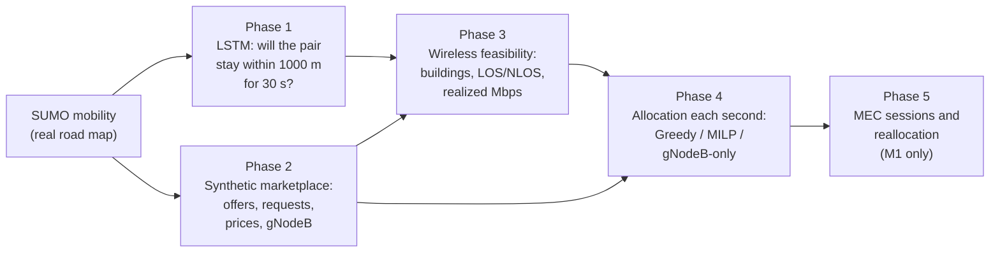
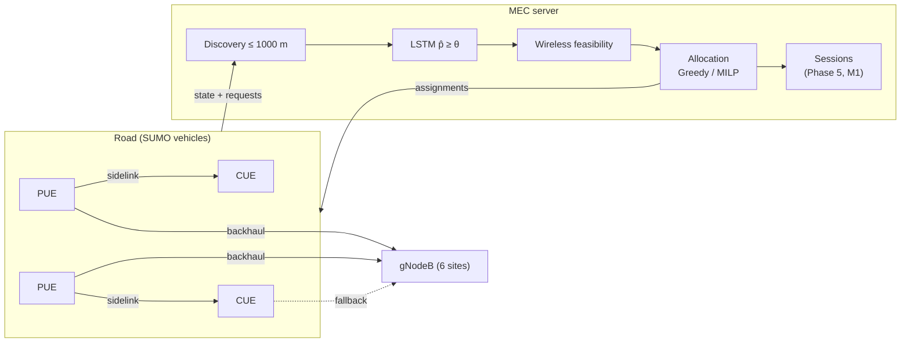
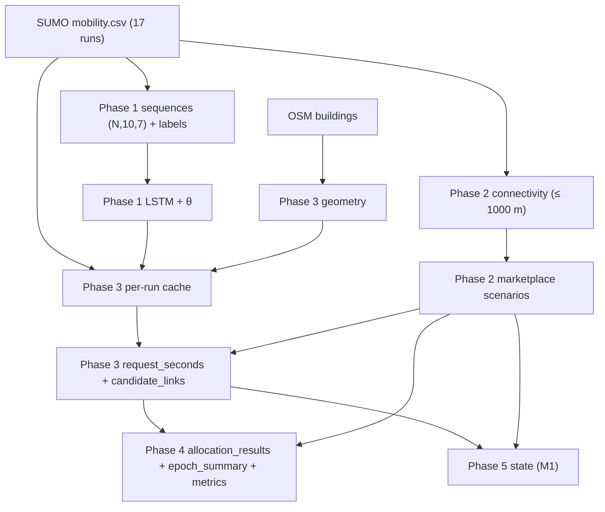

# MEC-Assisted Internet Sharing Marketplace with LSTM-Based Link Reliability Prediction and Resource Allocation

## Complete Technical Documentation

| Item | Value |
|---|---|
| Repository | `capstone_sim` |
| Documentation date | 2026-11-25 |
| Source of truth | The repository code, configuration files, recorded outputs and reports. Every number below names its source file. |
| Companion documents | [PROJECT_ARCHITECTURE.md](PROJECT_ARCHITECTURE.md), [PROFESSOR_PROJECT_GUIDE.md](PROFESSOR_PROJECT_GUIDE.md), [PROJECT_VIVA_QUESTIONS.md](PROJECT_VIVA_QUESTIONS.md) |

### Status at a glance

| Phase | Topic | Status (from repository evidence) |
|---|---|---|
| 1 | LSTM link-survival prediction | **Complete.** Model trained, verified, threshold selected on validation, evaluated once on test. |
| 2 | Synthetic marketplace data and scenarios | **Complete.** 156 scenarios × 2 splits, validated and byte-reproducible. |
| 3 | Building-aware wireless channel and link feasibility | **Complete** for validation and test splits. |
| 4 | Greedy / two-stage MILP allocation | **Complete.** Validation run, frozen (2026-11-25 01:10), test run completed (outputs written 01:51). |
| 5 | Dynamic MEC session management | **Partially implemented.** M0 (dependency verification) and M1 (configuration, input adapter, state manager) exist with 35 tests. **M2–M8 are not implemented.** No Phase 5 experiment outputs exist. |

---

## Table of Contents

1. [Project Overview](#1-project-overview)
2. [System Architecture](#2-system-architecture)
3. [Phase-wise Implementation](#3-phase-wise-implementation)
   - [Phase 1 — LSTM link reliability](#phase-1--lstm-based-link-reliability-prediction)
   - [Phase 2 — Marketplace data and scenarios](#phase-2--marketplace-data-and-scenario-generation)
   - [Phase 3 — Building-aware wireless channel](#phase-3--building-aware-wireless-channel-modelling)
   - [Phase 4 — Allocation and optimization](#phase-4--marketplace-resource-allocation-and-optimization)
   - [Phase 5 — Dynamic MEC sessions](#phase-5--dynamic-mec-session-management)
4. [Mathematical Formulation](#4-mathematical-formulation)
5. [Complete End-to-End Working Example](#5-complete-end-to-end-working-example-illustrative)
6. [Experimental Setup and Results](#6-experimental-setup-and-results)
7. [Design Decisions and Their Justification](#7-design-decisions-and-their-justification)
8. [Testing, Reproducibility and Integrity](#8-testing-reproducibility-and-integrity)
9. [Research Contribution, Novelty and Limitations](#9-research-contribution-novelty-and-limitations)
10. [Professor/Viva Preparation](#10-professorviva-preparation)
- [Appendix A — Inconsistencies and gaps found while documenting](#appendix-a--inconsistencies-and-gaps-found-while-documenting)
- [Appendix B — Glossary](#appendix-b--glossary)

---

## 1. Project Overview

### 1.1 The research problem in simple language

Many vehicles today carry a cellular modem with a data plan, but they rarely use all of it. Other vehicles
nearby may have no data, a weak signal, or an expensive plan. This project builds a **marketplace** in which:

- a **Provider UE (PUE)** — a vehicle with spare cellular Internet capacity — sells part of it,
- a **Consumer UE (CUE)** — a vehicle that needs Internet — buys it, and
- a **Multi-access Edge Computing (MEC) server** at the network edge acts as the market operator. It finds
  suitable providers, checks whether the link will hold, checks whether the radio link actually works, and
  decides who serves whom at what rate and price.

The **gNodeB** (the 5G base station) remains available as a fallback. It can serve a consumer directly, or
top up the part of the consumer's demand that a provider cannot carry.

### 1.2 Why share Internet between moving vehicles?

| Benefit | Explanation |
|---|---|
| Lower cost for consumers | A provider's posted price can be lower than the operator's price (in the data, PUE prices are drawn as 0.3–1.5 × the gNodeB price). |
| Better use of idle capacity | Spare backhaul on provider vehicles would otherwise go unused. |
| Relief for the base station | Traffic carried by PUEs does not consume gNodeB cell capacity, which helps when the cell is congested. |
| Coverage extension | A consumer just outside gNodeB coverage can still be served through a nearby provider that is inside coverage. |

### 1.3 Why mobility makes this hard

Vehicles move. A provider–consumer connection that works now may fail seconds later because:

1. **Distance grows** — the two vehicles drive apart (out of range).
2. **Buildings block the path** — in a city, the straight line between the vehicles can pass through a building.
3. **Other vehicles block the path** — trucks and cars between them attenuate the signal.
4. **The provider leaves** — it parks or leaves the road network (departure).
5. **The provider stops selling** — temporarily (unavailable) or permanently (withdrawal).
6. **The consumer leaves** — before its requested service ends.

A marketplace that ignores these effects would sell links that break. The project therefore separates the
question *"will these two vehicles stay close?"* (LSTM) from *"does the radio link work right now and how
fast?"* (channel model) and from *"who should serve whom at lowest cost?"* (optimizer).

### 1.4 Objective and research questions

**Overall objective.** Design, implement and evaluate an MEC-coordinated Internet-sharing marketplace for
vehicles that combines mobility-aware link reliability prediction, building-aware wireless feasibility and
economic resource allocation, and (as ongoing work) manages sessions dynamically when links fail.

Research questions as reflected in the implemented experiments:

| # | Research question | Where it is answered |
|---|---|---|
| RQ1 | Can an LSTM predict, from 10 s of movement history, whether a provider–consumer pair stays within communication range for the next 30 s, better than simple baselines? | Phase 1 (test ROC-AUC 0.8506 vs 0.8354 kinematic, 0.6562 distance) |
| RQ2 | How much does building-aware wireless modelling change which links are usable, compared with distance-only reasoning? | Phase 3 (G vs F1/F2/F3 scenarios) |
| RQ3 | How much does a provider marketplace improve admission and cost compared with a gNodeB-only network? | Phase 4 (MILP / greedy vs gNodeB-only, paired bootstrap CIs) |
| RQ4 | How close is a fast greedy heuristic to the exact two-stage MILP, and at what runtime cost? | Phase 4 (MILP vs greedy) |
| RQ5 | Can an MEC session manager keep consumers served when providers depart, withdraw or lose the link, and is reliability-aware selection better than reliability-unaware selection over time? | Phase 5 — **pending** (only the observation layer M1 exists) |

### 1.5 The complete system at a high level



---

## 2. System Architecture

### 2.1 Entities

| Entity | Role | Modelled as | Data |
|---|---|---|---|
| **PUE** | Sells spare Internet | NR sidelink **UE-to-Network relay UE** (3GPP Rel-17) | SUMO trajectory; Phase 2 registration, availability, backhaul `C_i`, access `A_i`, link peak, price `π_i` |
| **CUE** | Buys Internet | NR sidelink **remote UE** | SUMO trajectory; Phase 2 requests: rate `d_j`, duration, max price `π_j^max`, weight `w_j` |
| **MEC server** | Market coordinator | Offline decision logic (Phases 3–5) | Reads all files; `MEC-1` POI in `infrastructure.add.xml` is not used in calculations |
| **gNodeB** | Cellular base station and fallback | 6 fixed sites (`gNB-1` … `gNB-6`), nearest site within 2000 m (full) or 1500 m (gaps) serves | Available capacity per second, price 1.0/GB |
| **SUMO** | Traffic simulator | 17 runs of 1000 s on an OSM city network | `data/raw/sumo/` |
| **LSTM predictor** | Link-survival probability `p̂` | 2-layer LSTM, 54,081 parameters | `outputs/large_dataset_experiment/checkpoints/` |
| **Wireless channel model** | Radio feasibility and capacity | 3GPP TR 37.885 NR sidelink + building geometry | `src/network/`, `config/network/` |
| **Allocation engine** | Who serves whom, at what rate | Greedy heuristic, two-stage MILP (HiGHS), gNodeB-only baseline | `src/marketplace/` |

The technology framing is stated in `config/network/technologies.json` and `docs/network_models.md`:
PUE–CUE hop = PC5 sidelink, PUE Internet = cellular Uu backhaul through the gNodeB, MEC = coordinator.
Vehicle-mounted UEs are assumed; ordinary smartphones are **not** assumed to support sidelink relay.

### 2.2 Architecture diagram



### 2.3 End-to-end data flow



### 2.4 How information moves between components

| From → To | What is passed | File / interface |
|---|---|---|
| SUMO → Phase 1 | Per-second positions and speeds of every vehicle | `data/raw/sumo/<run>/mobility.csv` |
| Phase 1 → Phase 3 | Trained model, scaler, θ values | `best_model.pt`, `scaler.json`, `checkpoint_metadata.json` (θ = 0.62), `sensitivity_threshold.json` (θ = 0.65) |
| SUMO → Phase 2 | Vehicle roles, lifetimes, in-range pairs | `data/derived/connectivity/<run>/` |
| Phase 2 → Phase 3, 4, 5 | Provider resources and prices, requests, gNodeB capacity | `data/synthetic/marketplace/<split>/<scenario>/` |
| Phase 3 → Phase 4, 5 | For every active request-second: coverage, cell capacity; for every in-range pair: stage flags, `p_survive`, realized capacity | `data/simulation/phase3/<split>/<scenario>/{request_seconds, candidate_links}.csv.gz` |
| Phase 4 → Phase 5 | Frozen allocation code (re-used), pricing, units | Hash-pinned in `config/mec/phase5.json` |

A key design property: **later phases never recompute earlier ones.** Phase 4 does not run the LSTM or the
radio model; it reads the recorded `feasible_primary` / `feasible_sensitivity` flags and
`realized_link_capacity_mbps`. Phase 5 does the same.

---

## 3. Phase-wise Implementation

---

### Phase 1 — LSTM-Based Link Reliability Prediction

#### 1. What problem does this phase solve?

It estimates, for a provider–consumer pair at second *t*, the probability that the pair **stays within
communication range (1000 m) for every second of the next 30 s**. This is the "will the link survive?"
question.

#### 2. Why was this phase necessary?

If the MEC server assigns a provider that drives away after 5 s, the consumer's session breaks and must be
re-allocated. Selecting only pairs that are likely to stay together reduces such breaks. Distance alone is a
weak signal: two vehicles 300 m apart and approaching each other are a better choice than two vehicles
300 m apart and moving apart at 20 m/s.

#### 3. What was the input?

| Item | Value | Source |
|---|---|---|
| SUMO runs | 17 (`pilot_001`, `run_000` … `run_015`), 1000 s each, 1 s steps | `data/raw/sumo/*/run_config.json`, `scripts/generate_sumo_runs.py` |
| Traffic densities | light 46, medium 70, heavy 100, very heavy 136 vehicles (pilot: 50) | `data/processed/large_dataset/dataset_summary.json` |
| Role split | about 60 % PUE, 40 % CUE (e.g. 46 vehicles → 28 PUE, 18 CUE) | same |
| Sequences | 170,744 windows of shape (10 s × 7 features) | same |
| Class balance | 62.67 % survive (label 1), 37.33 % break (label 0) | same |

**Seven features per second** (`config/stage3_large_dataset.json`):

| # | Feature | Meaning |
|---|---|---|
| 1 | `distance_m` | Euclidean distance between PUE and CUE |
| 2 | `relative_speed_mps` | Magnitude of the velocity difference |
| 3 | `provider_speed_mps` | PUE speed |
| 4 | `consumer_speed_mps` | CUE speed |
| 5 | `delta_x_m` | x-displacement CUE relative to PUE |
| 6 | `delta_y_m` | y-displacement |
| 7 | `closing_speed_mps` | Rate at which distance shrinks (positive) or grows (negative) |

#### 4. What algorithms/models were used?

| Component | Choice | Source |
|---|---|---|
| Model | `LinkSurvivalLSTM`: 2 stacked LSTM layers, hidden size 64, dropout 0.3, unidirectional; head Linear(64→32) → ReLU → Dropout → Linear(32→1) | `src/models/lstm.py`, `config/stage3_large_dataset.json` |
| Parameters | 54,081 | `outputs/large_dataset_experiment/metrics/test_metrics.json` |
| Loss | Binary cross-entropy on logits (`BCEWithLogitsLoss`, no class weight in the pipeline that produced the checkpoint) | `scripts/run_large_dataset_pipeline.py:261` |
| Optimizer | Adam, learning rate 0.001, weight decay 1e-4, gradient clipping at norm 5 | `src/training/trainer.py`, config |
| Training | Batch 64, up to 60 epochs, early stopping with patience 10 | config |
| Scaling | Feature scaler fitted on training sequences only | `scaler.json`, report notes |
| Baselines | (a) Kinematic extrapolation (constant velocity), (b) distance threshold | `src/evaluation/baselines.py` |

#### 5. What exactly was implemented?

- Sequence and label builder (`src/features/sequence_builder.py`, `src/features/labels.py`).
- Run-disjoint splitter (`src/data/splitter.py`, `scripts/split_large_dataset.py`).
- LSTM model, training loop, checkpointing (`src/models/`, `src/training/`).
- Predictor wrapper `LinkSurvivalPredictor` with `metadata_path` for corrected metadata (`src/models/predictor.py`).
- Reliability interfaces: `ReliabilityModel`, LSTM adapter, kinematic model, `ThresholdPolicy` (`src/reliability/`).
- `OnlineFeatureBuilder` that reproduces the training windows **bitwise** for online use in Phase 3 (`src/reliability/online_features.py`).
- Verification and threshold scripts (`scripts/verify_predictor.py`, `scripts/sweep_reliability_threshold.py`, `scripts/threshold_grouped_ci.py`).

#### 6. How does the implementation work step by step?

1. For each run, for each PUE–CUE pair and each second *t* where the pair is within 1000 m and both vehicles
   have at least 10 s of history, build a 10 × 7 window over seconds [t−9, t].
2. Compute the **label** (see §4.2):
   - 1 if the distance stays ≤ 1000 m at every second t+1 … t+30;
   - 0 if it exceeds 1000 m at any of those seconds;
   - **no label (sample dropped)** if either vehicle is not present until t+30 (it departed or the trace ended).
3. Split by **run** so no run, vehicle or pair appears in two splits.
4. Fit the scaler on training windows only, train the LSTM with early stopping on validation loss
   (best epoch 13, best validation loss 0.3318).
5. Choose a **classification threshold** of 0.53 by maximizing validation balanced accuracy (original training run).
6. Choose the **reliability threshold θ** for the marketplace (separately, see below) on validation only.
7. Evaluate on test once at the fixed thresholds.

**Reliability threshold selection** (`outputs/large_dataset_experiment/reliability_threshold/selected_threshold.json`):

- Rule: the **smallest θ in [0.50, 0.90]** (step 0.01) such that **validation precision ≥ 0.90** and
  **validation recall ≥ 0.50**. Fallback (not needed): maximum balanced accuracy.
- θ values meeting both constraints: 0.62 … 0.74. The smallest, **θ\* = 0.62**, was selected.
- **Sensitivity variant θ = 0.65** (`reliability_threshold_robust/sensitivity_threshold.json`): the smallest θ
  whose *pair-clustered one-sided 95 % lower bound* on validation precision is ≥ 0.90 (bootstrap, B = 2000,
  594 pairs). At θ = 0.62 that lower bound is 0.8863, so 0.62 meets the target only as a point estimate.

#### 7. What is the output?

- `p̂_ij(t) ∈ [0, 1]`: probability that the pair survives 30 s.
- Decision: **reliable** if `p̂ ≥ θ` (θ = 0.62 primary, 0.65 sensitivity).
- Phase 3 records, per candidate row: `p_survive`, `lstm_window_available`, `reliable_primary`, `reliable_sensitivity`.

#### 8. How does this phase connect to the next phase?

Phase 3 loads the unchanged checkpoint, rebuilds windows online for every candidate pair-second
(bitwise equal to the training windows, verified by `tests/test_simulation.py::test_bitwise_equal_to_training_windows`),
and applies θ as **one stage** of link feasibility. The 1000 m range is fixed everywhere because the LSTM's
labels were defined with it; changing the range would require retraining.

#### 9. What experiments and tests were conducted?

| Experiment / test | Evidence |
|---|---|
| Test-set evaluation vs two baselines | `metrics/test_metrics.json`, `reports/experiment_summary.md` |
| Threshold sweep on validation (0.50–0.90) | `reliability_threshold/threshold_sweep_val.csv`, `.png` |
| Pair/consumer-clustered bootstrap CIs on validation precision | `reliability_threshold_robust/grouped_ci_val.csv` |
| Single test evaluation at θ = 0.62 | `reliability_threshold/test_metrics_at_selected_threshold.json` |
| Predictor reproduction of recorded test metrics | `verification/predictor_verification.json` (all differences 0.0) |
| Unit tests | `test_model.py`, `test_labels.py`, `test_kinematics.py`, `test_predictor.py`, `test_checkpoints.py`, `test_split_manifest.py`, `test_splitter.py`, `test_metrics.py`, `test_reliability_interfaces.py` |

#### 10. What are the results?

**Dataset split** (`reports/experiment_summary.md`, `data/splits/large_dataset/split_audit.json`):

| Split | Runs | Sequences | Survive | Break | Vehicles | Pairs |
|---|---|---|---|---|---|---|
| Train | pilot_001, 002, 003, 007, 008, 009, 011, 014, 015 | 119,529 | 62.8 % | 37.2 % | 789 | 2,624 |
| Validation | 000, 001, 006, 013 | 25,602 | 63.0 % | 37.0 % | 261 | 594 |
| Test | 004, 005, 010, 012 | 25,613 | 61.9 % | 38.1 % | 233 | 550 |

Overlap of runs, vehicles and pairs across splits: **0** (audit passed).

**Test results at the classification threshold 0.53** (`metrics/test_metrics.json`):

| Model | ROC-AUC | PR-AUC | F1 | Bal. acc. | Precision | Recall | Specificity | Brier |
|---|---|---|---|---|---|---|---|---|
| **LSTM** | **0.8506** | **0.8967** | 0.788 | **0.7591** | **0.8454** | 0.738 | **0.7802** | **0.1574** |
| Kinematic extrapolation | 0.8354 | 0.8783 | **0.7941** | 0.7532 | 0.8292 | **0.7618** | 0.7445 | 0.1951 |
| Distance threshold (d\* = 740 m) | 0.6562 | 0.7388 | 0.6692 | 0.6176 | 0.7235 | 0.6224 | 0.6128 | 0.2671 |

Honest reading: the LSTM is clearly better than a distance threshold and better than kinematic extrapolation
on ranking (ROC-AUC +0.015), calibration (Brier 0.157 vs 0.195), precision and specificity, but **not on F1
or recall**. The repository report states this explicitly.

**Reliability threshold θ = 0.62** — validation vs test (kept strictly separate):

| Metric | Validation (selection) | Test (single evaluation) |
|---|---|---|
| Precision | 0.9001 | 0.8803 |
| Recall | 0.6672 | 0.6343 |
| Specificity | 0.874 | 0.8595 |
| F1 | 0.7663 | 0.7373 |
| Approved-link break rate (= 1 − precision) | 0.0999 | 0.1197 |
| ROC-AUC | 0.8709 | 0.8506 |

Sources: `reliability_threshold/selected_threshold.json` (validation), `reliability_threshold/test_metrics_at_selected_threshold.json` (test).
The test precision (0.880) is **below the 0.90 target**; θ was deliberately **not** changed after seeing test data.

#### 11. Limitations and assumptions

- The LSTM predicts **geometric survival** (distance ≤ 1000 m), not radio quality or throughput.
- Samples whose vehicles leave within 30 s are **dropped** from training (no label), so the model is not trained to predict departures.
- Test runs contain no 136-vehicle (very heavy) traffic; high-density behaviour is untested.
- Loss curves were never saved (a checkpoint-saving bug crashed the original pipeline after training); only the best epoch (13) and its loss (0.3318) are known. The bug is fixed; the model was not retrained.
- The checkpoint file itself stores stale metadata (`best_threshold = 0.5`, `val_f1 = 0.0`); the corrected values live in `checkpoint_metadata.json`.
- Pair-level confidence intervals are optimistic because pairs within a run share traffic; 4 validation runs are too few for a run-level interval.

#### Link survival vs bandwidth prediction

| | Link survival (this project) | Bandwidth prediction (not done) |
|---|---|---|
| Question | Will the pair stay within 1000 m for 30 s? | How many Mbps will the link deliver? |
| Output | Probability in [0, 1] | A rate in Mbps |
| Depends on | Relative motion only | Distance, buildings, blockage, interference, scheduling |
| Used for | Filtering pairs (`p̂ ≥ θ`) | — |
| In this project, bandwidth comes from | — | The Phase 3 channel model (realized capacity), not from the LSTM |

---

### Phase 2 — Marketplace Data and Scenario Generation

#### 1. What problem does this phase solve?

There is no public dataset of vehicles selling Internet to each other. Phase 2 creates a **reproducible
synthetic marketplace** on top of the real SUMO movement: which vehicles offer service, at what capacity and
price, which vehicles request service, how much, for how long, at what maximum price, and how loaded the
gNodeBs are.

#### 2. Why was this phase necessary?

An optimizer needs offers, requests, prices and capacities. Without controlled, documented data, results could
not be reproduced or compared across conditions (low/high supply, cheap/expensive providers, congested cells).

#### 3. What was the input?

- SUMO traces of the **validation** runs (000, 001, 006, 013) and **test** runs (004, 005, 010, 012). Training
  runs are not used for the marketplace.
- Assumed parameters in `config/marketplace/base.json` and the scenario design in `config/marketplace/scenarios.json`.
- gNodeB site positions from `infrastructure.add.xml`.

#### 4. What algorithms/models were used?

| Element | Model | Parameter values (assumptions) |
|---|---|---|
| PUE registration | Registers with probability `p_register` after U{0..30} s delay; stays registered until it departs or withdraws | `p_register` calibrated: low 0.10, med 0.20, high 0.35 |
| PUE availability | On/off Markov chain | mean on 300 s; mean off 60 s (120 s for low availability) |
| PUE backhaul `C_i` | base × clip(exp(z_t), 0.5, 1.2), z an AR(1) process (ρ = 0.95, σ = 0.2) | base U(5, 40) Mbps |
| PUE access `A_i` | Fixed per PUE | U(20, 80) Mbps |
| PUE link peak | Fixed per PUE (cap inside C3) | U(20, 50) Mbps |
| PUE price `π_i` | gNodeB price × uniform factor | mixed U(0.4, 1.2), cheap U(0.3, 0.7), expensive U(0.8, 1.5) |
| PUE withdrawal | Permanent, per-second hazard while registered | none 0; some 1/600 per s |
| CUE participation | 60 % of consumers ever request | — |
| Request arrivals | Exponential idle gaps, at most one active request per CUE, open-loop | λ = 1/300, 1/120, 1/45 per s (low/med/high demand) |
| QoS classes | web 1–2 Mbps, 30–120 s; video_sd 3 Mbps, 60–300 s; video_hd 5–8 Mbps, 60–300 s; bulk 10–20 Mbps, 30–90 s | class mix depends on demand level |
| Max price `π_j^max` | gNodeB price × U(0.6, 1.5) | — |
| gNodeB | 6 fixed sites; background load ρ_load · G_tot · exp(z_t), AR(1) | G_tot = 30 Mbps (calibrated); load fraction 0.3 (sufficient) or 0.8 (insufficient); radius 2000 m (full) or 1500 m (gaps) |
| Random numbers | `SeedSequence([base_seed, crc32(run_id), replicate, stream, entity_id])`, base seed 20261124 | common random numbers across configurations |

Derived quantities (exact, `docs/datasets.md` §3):

- `data_volume_gb = required_rate_mbps × service_duration_s / 8000`
- `max_budget = max_price_per_gb × data_volume_gb`

#### 5. What exactly was implemented?

`src/datagen/` (connectivity, scenarios, generators, metrics, validate, stats, io_utils) and
`scripts/generate_marketplace_data.py`, plus calibration and freezing logic.

**Scenario design** (`config/marketplace/scenarios.json`) — one-factor-at-a-time around a baseline plus
three stress combinations, **13 configurations**:

| ID | Change from baseline (availability med, demand med, price mixed, gNodeB sufficient, coverage full, no withdrawals) |
|---|---|
| C00_baseline | — |
| C01_avail_low / C02_avail_high | Provider availability low / high |
| C03_demand_low / C04_demand_high | Demand low / high |
| C05_price_cheap / C06_price_expensive | PUE prices cheap / expensive |
| C07_gnb_insufficient | gNodeB background load 0.8 |
| C08_coverage_gaps | gNodeB radius 1500 m |
| C09_withdrawals_some | Withdrawal hazard 1/600 s |
| S01_highdemand_gnbinsufficient | High demand + insufficient gNodeB |
| S02_lowavail_withdrawals | Low availability + withdrawals |
| S03_expensive_coveragegaps | Expensive PUEs + coverage gaps |

13 configurations × 4 runs × 3 replicates = **156 scenarios per split**, for both validation and test.

#### 6. How does the implementation work step by step?

1. Load the run's SUMO trace (roles and lifetimes from the data).
2. Derive `pairwise_connectivity` (all PUE–CUE pairs within 1000 m per second, with `history_ok`) and a
   separate `pairwise_ground_truth` (future information, **evaluation only**).
3. **Calibrate on validation runs only** under reference conditions: choose `p_register` per availability
   level (target supply/demand ratios 0.5, 1.0, 2.0) and `G_tot` per gNodeB level. Freeze them with SHA-256
   hashes of every config file (`config/marketplace/frozen/`).
4. For every (configuration, run, replicate): draw PUE registration, availability, capacities, prices and
   withdrawals; CUE requests; gNodeB load. Write files.
5. Validate every scenario (40 checks per scenario) and regenerate everything to verify byte-identical output.
6. Generate the test split only after freezing; generation refuses to run if a config changed.

#### 7. What is the output?

```
data/synthetic/marketplace/<split>/<config>__<run>__r<rep>/
    pue_resources.csv.gz      per PUE per second: registered, available, C5, C4, link peak, price
    pue_withdrawals.csv       pue_id, withdraw_time_s, reason (permanent)
    cue_requests.csv.gz       request_id, cue_id, time, QoS class, rate, duration, volume, max price, budget, weight
    gnodeb_resources.csv.gz   per site per second: total, background load, available capacity, price
    gnodeb_sites.csv, scenario_meta.json
```

Units throughout: seconds, metres, Mbps, decimal GB (1 GB = 8000 Mb), price units per GB, gNodeB price = 1.0.

#### 8. How does this phase connect to the next phase?

Phase 3 combines these synthetic resources with the real mobility and the channel model to decide, per
second, which provider–consumer links are feasible. Phase 4 reads prices, budgets and capacities directly.

#### 9. What experiments and tests were conducted?

- Calibration on validation runs (`config/marketplace/frozen/calibration_report.json`).
- 6,216 scenario checks per split + connectivity checks per run (`validation_report.json`).
- Reproducibility: 780 files regenerated and hash-compared per split (`reproducibility_report.json`).
- Connectivity rows reproduce the LSTM dataset's (time, pair, label) sets exactly for run_000 and run_013 (CHANGELOG).
- Unit tests: `test_generators.py` (10), `test_connectivity.py` (3), `test_link_capacity.py` (4), `test_mobility_source.py` (3).

#### 10. What are the results?

| Result | Value | Source |
|---|---|---|
| Calibrated `p_register` | low 0.10 (achieved supply/demand 0.46), med 0.20 (1.03), high 0.35 | `calibration_report.json` |
| gNodeB total capacity | 30 Mbps for both levels; carry share 0.984 (sufficient) vs 0.671 (insufficient) on validation | CHANGELOG Phase 2 |
| Validation checks | 156 scenarios, 6,216 checks, all passed (val and test) | `data/synthetic/marketplace/{val,test}/validation_report.json` |
| Reproducibility | 780 files compared per split, 0 mismatches | `reproducibility_report.json` |
| Budget pressure | About 46 % of requests have `max_price_per_gb` below the gNodeB price | CHANGELOG Phase 2 findings |

#### 11. Limitations and assumptions

- **All marketplace attributes are synthetic assumptions**; only mobility is real SUMO output.
- No battery or energy model; no strategic behaviour (providers do not adapt prices).
- Equal priority weights (`priority_weight = 1.0`), so admission counts requests.
- Requests are open-loop: a rejected consumer does not retry or change its request.
- Demand per scenario is small (on the order of 15 requests, mean concurrency about 1.4, per the Phase 2 findings), a property of the traces.

**Why synthetic data is required.** No public dataset links vehicle trajectories with sidelink offers, prices
and requests. Synthetic data with documented assumptions, common random numbers and frozen calibration
allows fair, controlled comparisons — at the cost of external validity.

---

### Phase 3 — Building-Aware Wireless Channel Modelling

#### 1. What problem does this phase solve?

It determines, for every second and every in-range provider–consumer pair, whether the **radio link actually
works** and **how many Mbps it can carry**, taking buildings into account. It also combines all eligibility
stages (provider status, LSTM, wireless, resources) and records the first stage that fails.

#### 2. Why was this phase necessary?

Distance alone is insufficient. From `docs/network_models.md` §5 (urban, NR sidelink, 6 GHz, 20 MHz):

| Distance | Capacity at median, same street (LOS) | Capacity at median, building-blocked (NLOS) |
|---|---|---|
| 100 m | 88.0 Mbps | 39.5 Mbps |
| 200 m | 88.0 Mbps | 12.8 Mbps |
| 500 m | 88.0 Mbps | 0.0 Mbps |
| 1000 m | 71.9 Mbps | 0.0 Mbps |

Two pairs at the same distance can differ from 88 Mbps to zero depending on whether a building is in the way.
In the validation data, the building-blocked share rises from 1.2 % at ≤ 100 m to 59.2 % at 750–1000 m.

#### 3. What was the input?

- SUMO traces; Phase 2 scenarios; the Phase 1 LSTM and thresholds.
- Building footprints from the OSM file used to build the SUMO network, converted with SUMO `polyconvert`
  into the **exact network coordinate system** (UTM 43N + network offset). 3,951 polygons, 0 rejected
  (`data/derived/geometry/geometry_manifest.json`).
- Link model `nr_sidelink_tr37885_v1` (`config/network/link_profiles_nr.json`).
- Channel seed 20261125 (`config/simulation/phase3.json`).

#### 4. What algorithms/models were used?

| Component | Method | Source |
|---|---|---|
| Building index | Grid spatial index (100 m cells); segment–polygon interior intersection test; agrees with brute force in tests | `src/network/buildings.py` |
| Channel states | LOS, NLOSv (blocked by vehicles), NLOS (blocked by buildings) — 3GPP TR 37.885 §6.2 | `src/network/channel_state.py` |
| LOS probability (urban, building-clear) | `P_LOS = min(1, 1.05·exp(−0.0114·d))` | TR 37.885 Table 6.2-1 |
| Path loss | LOS/NLOSv: `38.77 + 16.7·log10 d + 18.2·log10 f_c`; NLOS: `36.85 + 30·log10 d + 18.9·log10 f_c` | TR 37.885 Table 6.2.1-1 |
| Shadowing | σ = 3 dB (LOS, NLOSv), 4 dB (NLOS) | same |
| Vehicle blockage (NLOSv) | max(0, X), X ~ N(5 + max(0, 15·log10 d − 41), 4²) dB (case 3) | TR 37.885 §6.2.1 |
| SNR → throughput | 0 if SNR < −10 dB, else `B · min(0.6·log2(1+SNR), 4.4)` | TR 36.942 Annex A.1 |
| Parameters | f_c = 6 GHz, B = 20 MHz, P_tx = 23 dBm, antenna gains 3 + 3 dBi, NF = 9 dB, antenna height 1.6 m | `docs/network_models.md` §4 |

**Four channel scenarios** (never mixed):

| Label | Rule | Role |
|---|---|---|
| **G** | Building geometry decides NLOS; building-clear paths use urban P_LOS | **Primary** (optimistic, because OSM buildings are incomplete) |
| **F1** | Same OSM road → LOS/NLOSv; different road → NLOS | Road-topology approximation |
| **F2** | All NLOS | Conservative bound |
| **F3** | All building-clear (LOS/NLOSv) | Optimistic bound |

#### 5. What exactly was implemented?

- `src/network/`: link-model interface, TR 37.885 model, building layer, classifiers G/F1/F2/F3,
  `assign_episode_states`, realized SNR/capacity methods.
- `src/simulation/`: per-run channel and reliability caches, per-scenario feasibility, validation, statistics.
- `scripts/build_building_geometry.py`, `scripts/run_phase3_simulation.py`.

#### 6. How does the implementation work step by step?

1. **Per run (cached, scenario-independent):** for every in-range pair-second:
   - classify the channel state probabilities under G, F1, F2, F3;
   - define **link episodes** (maximal runs of consecutive seconds where the pair is a candidate);
   - for each episode draw one uniform `U` (state) and two standard normals `z_shadow`, `z_blockage`,
     keyed by (seed, run, PUE, CUE, episode start), shared across G/F1/F2/F3;
   - **realized state** = LOS if U < P_LOS, NLOSv if U < P_LOS + P_NLOSv, else NLOS (building status and
     distance re-evaluated every second, so the state changes only when P_LOS(d) crosses U or a building
     starts/stops blocking);
   - realized SNR = median-state SNR − σ·z_shadow − [NLOSv] max(0, μ_b + σ_b·z_blockage);
   - realized radio capacity from the TR 36.942 mapping;
   - LSTM `p_survive` from the online window;
   - episode end cause (out_of_range, pue_departure, cue_departure, both_departure, trace_end) — **evaluation only**.
2. **Per scenario:** join with Phase 2 to get provider status and C3/C4/C5, apply the stages in order and
   record each stage flag and the **first failure**:

| Order | Stage | Failure label |
|---|---|---|
| pre | Geographic range ≤ 1000 m | counted per request-second (`n_out_of_range_pue`) |
| 1 | Provider registered and available | `provider_unavailable` |
| 2 | LSTM window (≥ 10 s history) | `insufficient_history` |
| 3 | `p̂ ≥ θ` | `reliability_below_threshold` |
| 4 | Realized radio capacity > 0 | `wireless_outage_building_blocked` / `_vehicle_blocked` / `_los` / `_nlos_assumed` / `_fallback` |
| 5 | min(C3, C4, C5) > 0 | `resource_zero` |
| — | all pass | `feasible` |

3. Record gNodeB coverage, serving cell and available cell capacity per request-second.

**Expected vs realized capacity** — two different quantities, never confused:

| Column | Meaning | Used for |
|---|---|---|
| `expected_radio_capacity_mbps` | Average capacity over state probabilities, shadowing and blockage | Reporting only |
| `expected_outage_probability` | P(SNR < −10 dB) | Reporting only |
| `realized_radio_capacity_mbps` | Capacity of the one sampled channel of this episode | Wireless feasibility |
| `realized_link_capacity_mbps` | C3 = min(link_peak_i, realized radio capacity) | **Allocation input** |

A test (`test_expected_capacity_never_drives_feasibility`) swaps the expected values for contradictory
ones and checks that no feasibility output changes.

**Outage probability** for reporting is computed in closed form for LOS/NLOS and by integrating over the
blockage variable for NLOSv; expected capacity uses dense trapezoidal grids (Gauss–Hermite was rejected
because the integrands are discontinuous; checked against Monte Carlo).

#### 7. What is the output?

`data/simulation/phase3/<split>/<scenario>/request_seconds.csv.gz` and `candidate_links.csv.gz`, plus
per-run caches `data/derived/phase3_cache/<run>/{channel, reliability, episodes}.csv.gz` and split-level
`phase3_stats.json`, `validation_report.json`, `reproducibility_report.json`, `experiment_config.json`.

#### 8. How does this phase connect to the next phase?

Phase 4 reads `feasible_primary` / `feasible_sensitivity` (the eligible link set) and
`realized_link_capacity_mbps` (B_l) for the chosen channel scenario, and the gNodeB coverage and capacity
from `request_seconds`. Nothing is recomputed.

#### 9. What experiments and tests were conducted?

- Full val and test runs of all 156 scenarios × 4 channel scenarios × 2 thresholds.
- Validation checks (val 2,340; test 2,652; all passed) and full reproducibility rebuild in a scratch directory
  (312 files per split, 0 mismatches, cache hashes identical).
- Unit tests: `test_channel_state.py` (25), `test_network_models.py` (14), `test_simulation.py` (16).

#### 10. What are the results?

Source: `data/simulation/phase3/{val,test}/phase3_stats.json` (all 156 scenarios pooled).

| Metric | G (val) | G (test) | F1 (val) | F2 (val) | F3 (val) |
|---|---|---|---|---|---|
| Candidate link-seconds | 394,893 | 412,517 | 394,893 | 394,893 | 394,893 |
| Realized LOS / NLOSv / NLOS | 2.5 / 53.5 / 44.0 % | 3.9 / 49.8 / 46.3 % | 0.5 / 1.1 / 98.3 % | 0 / 0 / 100 % | 2.6 / 97.4 / 0 % |
| Realized outage share | 37.7 % | 40.4 % | 74.5 % | 74.6 % | 0.0 % |
| Mean realized radio capacity | 35.5 Mbps | 35.0 Mbps | 4.8 Mbps | 4.0 Mbps | 58.7 Mbps |
| Feasible share (θ = 0.62) | 4.35 % | 4.25 % | 2.36 % | 2.36 % | 5.98 % |
| Feasible share (θ = 0.65) | 4.07 % | 4.01 % | 2.26 % | 2.26 % | 5.56 % |

First failing stage, G, θ = 0.62:

| First failure | Validation | Test |
|---|---|---|
| `provider_unavailable` | 87.5 % | 85.2 % |
| `reliability_below_threshold` | 6.4 % | 8.7 % |
| `wireless_outage_building_blocked` | 1.6 % | 1.7 % |
| `insufficient_history` | 0.12 % | 0.15 % |
| `feasible` | 4.35 % | 4.25 % |

Link episode end causes (evaluation-only ground truth):

| Split | Episodes | out_of_range | pue_departure | cue_departure | both | trace_end (censored) | Mean duration |
|---|---|---|---|---|---|---|---|
| Validation | 839 | 476 | 150 | 155 | 2 | 56 | 46.1 s |
| Test | 762 | 480 | 135 | 109 | 2 | 36 | 47.3 s |

Interpretation:

- Most candidate pairs fail because the provider is **not registered or not available** — a consequence of
  the assumed registration probability (0.20 in the baseline), not of the radio.
- Among registered pairs, the LSTM removes more pairs than the radio under G, but under F1/F2 the radio
  dominates (74 % outage).
- Expected and realized mean capacity agree closely (G val 35.6 vs 35.5 Mbps), which is a consistency check
  on the sampling.
- About 18 % of episodes end by departure of the provider (150/839 val) — this is the case the LSTM
  does not predict and Phase 5 is meant to handle.

#### 11. Limitations and assumptions

1. OSM buildings are incomplete (28.7 % of driven 250 m cells contain no mapped building), so **G is optimistic**.
2. No building heights: every footprint blocks (2-D test).
3. The urban LOS/NLOSv formula is applied to all building-clear paths, an extension beyond TR 37.885's same-street definition.
4. No spatially correlated shadowing; per-episode draws only.
5. SNR not SINR: no interference, no resource-pool congestion, no half-duplex effects.
6. Antenna pattern ignored (3 dBi max gain), all vehicles 1.6 m antennas.
7. Throughput mapping uses LTE-derived (E-UTRA DL) parameters applied to NR sidelink.
8. Relay protocol aspects (L2/L3 relay, PDU sessions, path switching) abstracted away.

#### LSTM reliability vs physical wireless feasibility

| | LSTM reliability (Phase 1) | Wireless feasibility (Phase 3) |
|---|---|---|
| Question | Will the pair still be within 1000 m in each of the next 30 s? | Does the radio link work **now**, and at how many Mbps? |
| Time | Future (30 s ahead) | Current second |
| Inputs | Motion history only | Distance, buildings, channel state, shadowing, blockage |
| Output | Probability `p̂` | Realized capacity (Mbps), outage yes/no |
| Can it be wrong in the other's way? | A pair can stay close (LSTM correct) but be blocked by a building (radio fails). | A pair can have 80 Mbps now but drive apart in 10 s. |

Both must pass; neither replaces the other.

---

### Phase 4 — Marketplace Resource Allocation and Optimization

#### 1. What problem does this phase solve?

Every second, given the active requests, the eligible provider links and the gNodeB capacity, decide:
which requests to **admit**, which **one PUE** (if any) serves each admitted request, at what **rate**, how
much the **gNodeB** supplies, and what each consumer **pays**.

#### 2. Why was this phase necessary?

Eligibility alone does not say who should be served. Providers have limited backhaul and access capacity,
cells have limited capacity, and consumers have budgets. The choice determines how many consumers are
served and at what total cost.

#### 3. What was the input?

| Quantity | Symbol | Source (read from files, nothing recomputed) |
|---|---|---|
| Eligible links | `L` | Phase 3 `candidate_links`: `channel_scenario == C` and `feasible_<θ> == True` |
| Link capacity (C3) | `B_l` | `realized_link_capacity_mbps` (realized, never expected) |
| PUE access (C4), backhaul (C5) | `A_i`, `C_i` | `access_capacity_mbps`, `backhaul_capacity_mbps` (checked equal to Phase 2) |
| Demand, weight, max price | `d_j`, `w_j`, `π_j^max` | Phase 2 `cue_requests` |
| PUE price | `π_i` | Phase 2 `pue_resources` |
| Cell capacity, coverage, serving cell | `G_k`, `cov_j`, `k(j)` | Phase 3 `request_seconds` |
| gNodeB price | `π_g` | Phase 2 (constant 1.0) |

#### 4. What algorithms/models were used?

| Method | Description | Source |
|---|---|---|
| **MILP** (two-stage lexicographic) | Stage 1 maximizes the weighted number of admitted requests `W*`; Stage 2 minimizes total cost subject to admitting at least `W*`. HiGHS via `scipy.optimize.milp`, `mip_rel_gap = 0`, 30 s time limit. | `src/marketplace/milp.py` |
| **Greedy** | Requests in order weight ↓, arrival ↑, id ↑; each takes its cheapest budget-feasible option (gNodeB-only, or one PUE at its cost-minimal rate plus gNodeB remainder) given remaining C4/C5/C7; then resources are reduced. | `src/marketplace/greedy.py`, `admission.py` |
| **gNodeB-only** | Same MILP with no PUE links (baseline). | `scripts/run_phase4_allocation.py` |

#### 5. What exactly was implemented?

`src/marketplace/`: `problem.py` (EpochProblem), `eligibility.py` (builds problems from files), `pricing.py`
(posted prices, scaled cost, payments), `admission.py` (single-request options, rejection reasons),
`greedy.py`, `milp.py`, `allocation.py` (Allocation, rate-based PUE recording, independent audit),
`evaluation.py` (metrics, dominance checks, paired bootstrap). Runner: `scripts/run_phase4_allocation.py`
with commands `benchmark`, `run`, `freeze`, `repro-check`.

#### 6. How does the implementation work step by step?

1. For each scenario, load all inputs once (`ScenarioInputs`).
2. For each channel scenario (G, F1, F2, F3) and θ tag (primary, sensitivity), build one `EpochProblem` per
   active second.
3. Solve with greedy and MILP; solve gNodeB-only once per epoch (independent of channel and θ).
4. Record the PUE assignment **from the rates**, never from the binary `x`: a request has a PUE only if it
   receives > 10⁻⁶ Mbps from it. (HiGHS sometimes returns `x = 1` with `r = 0`, a "phantom x"; these are
   counted and never recorded as assignments: 20,444 on validation, 20,152 on test.)
5. **Audit** every solution independently against C1–C9, phantom PUE and non-negativity.
6. **Dominance checks**: MILP must admit at least as many as greedy and gNodeB-only; at equal admission it
   must cost no more.
7. Compute per-scenario metrics; compare methods with **paired differences** per scenario and a bootstrap
   95 % CI over the 156 scenarios (B = 2000, seed 42).
8. **Freeze** code and configuration (SHA-256) after validation. The test run refuses to start without the
   freeze or if any hash changed.

**Rejection reasons** (fixed order, same for all methods):

| Code | Meaning |
|---|---|
| `no_service_option` | Not covered by the gNodeB and no eligible PUE link |
| `insufficient_capacity_standalone` | No capacity-feasible option even with all resources free |
| `budget_exceeded` | Capacity-feasible options exist, but every one costs more than the consumer's max price |
| `capacity_contention` | Could be served alone, but not together with the admitted set |

**Why admission first, cost second.** If cost were minimized alone, the cheapest solution would be to
reject everyone (cost 0). Making admission the first objective forbids that; only among solutions that
admit the maximum number of requests is the cheapest chosen. Since every admitted request receives exactly
its demand (C6), total delivered throughput is fixed by Stage 1, so a separate throughput objective would have
no effect (it was removed; see `docs/formulation.md` §7).

#### 7. What is the output?

Per scenario: `allocation_results.csv.gz` (per method, channel, θ, second, request: admitted, PUE, rates,
payment, served-by, rejection reason) and `epoch_summary.csv.gz` (per epoch: sizes, objectives, runtime,
phantom x, audit violations). Per split: `metrics.csv.gz`, `comparison.json`, `validation_report.json`,
`phase4_manifest.csv`, `experiment_config.json`.

#### 8. How does this phase connect to the next phase?

Phase 4 is a **snapshot** allocator: each second is solved independently, so a consumer can be served by
PUE A at second t and PUE B (or rejected) at t+1. Phase 5 is designed to add sessions on top of it, reusing
the frozen Phase 4 code (hash-pinned).

#### 9. What experiments and tests were conducted?

- Runtime benchmark on 10 validation scenarios (`data/allocation/phase4/benchmark/val_benchmark.json`).
- Full validation run, freeze, reproducibility checks (`data/allocation/phase4/freeze/`).
- Full test run with the frozen code.
- 22 unit tests (`tests/test_marketplace.py`) on hand-built epochs with known optimal answers, audit
  detection per constraint family, phantom handling, pricing, isolation from reliability/radio code.

#### 10. What are the results?

**Integrity** (`data/allocation/phase4/{val,test}/validation_report.json`):

| Check | Validation | Test |
|---|---|---|
| Audit violations (C1–C9, phantom, non-negativity) | 0 | 0 |
| MILP admits less than greedy / gNodeB-only | 0 / 0 | 0 / 0 |
| MILP costs more at equal admission (vs greedy / gNodeB-only) | 0 / 0 | 0 / 0 |
| Phantom-x events handled | 20,444 | 20,152 |

**Overall means over 156 scenarios — primary channel G, θ = 0.62** (`comparison.json → overall_mean`):

| Method | Split | Admitted share of request-seconds | Payment per GB | PUE share of delivered volume | Runtime per scenario (s) |
|---|---|---|---|---|---|
| gNodeB-only | Validation | 0.5297 | 1.0000 | 0 % | 2.58 |
| Greedy | Validation | 0.5488 | 0.9746 | 8.78 % | 0.060 |
| MILP | Validation | 0.5489 | 0.9745 | 8.81 % | 3.07 |
| gNodeB-only | **Test** | 0.4648 | 1.0000 | 0 % | 2.81 |
| Greedy | **Test** | 0.4811 | 0.9708 | 7.79 % | 0.064 |
| MILP | **Test** | 0.4813 | 0.9708 | 7.82 % | 3.34 |

**Paired comparisons with 95 % bootstrap CIs (G, θ = 0.62)**:

| Comparison | Split | Δ admitted share | Δ payment per GB | Δ PUE volume share | Scenarios where first admits more |
|---|---|---|---|---|---|
| MILP − gNodeB-only | Validation | **+0.0192** [0.0155, 0.0232] | **−0.0255** [−0.0308, −0.0207] | +0.0881 [0.0732, 0.1033] | 103 / 156 (never fewer) |
| MILP − gNodeB-only | Test | **+0.0165** [0.0130, 0.0202] | **−0.0292** [−0.0351, −0.0234] | +0.0782 [0.0641, 0.0938] | 95 / 156 (never fewer) |
| MILP − greedy | Validation | +0.000085 [0.000019, 0.000174] | −0.000044 [−0.000111, −0.000004] | +0.00031 | 4 / 156 (never fewer); 140 identical |
| MILP − greedy | Test | +0.000175 [0.000026, 0.000392] | −0.000027 [−0.000078, +0.000021] | +0.00026 | 6 / 156 (never fewer); 127 identical |

**By channel scenario (MILP, θ = 0.62, admitted share / PUE volume share):**

| Split | gNodeB-only | F1 | F2 | G | F3 |
|---|---|---|---|---|---|
| Validation | 0.5297 / 0 | 0.5390 / 4.6 % | 0.5390 / 4.6 % | 0.5489 / 8.8 % | 0.5581 / 13.2 % |
| Test | 0.4648 / 0 | 0.4727 / 4.2 % | 0.4727 / 4.2 % | 0.4813 / 7.8 % | 0.4885 / 11.0 % |

**By configuration (MILP vs gNodeB-only, G, θ = 0.62, admitted share)** — `comparison.json → per_config_mean`:

| Configuration | Val gNB-only | Val MILP | Test gNB-only | Test MILP |
|---|---|---|---|---|
| C00_baseline | 0.592 | 0.611 | 0.528 | 0.541 |
| C02_avail_high | 0.592 | 0.627 | 0.528 | 0.557 |
| C05_price_cheap | 0.592 | 0.631 | 0.528 | 0.551 |
| C06_price_expensive | 0.592 | 0.593 | 0.528 | 0.529 |
| C07_gnb_insufficient | 0.394 | 0.429 | 0.352 | 0.377 |
| C08_coverage_gaps | 0.402 | 0.429 | 0.326 | 0.354 |
| S01_highdemand_gnbinsufficient | 0.327 | 0.367 | 0.300 | 0.331 |

**Rejection reasons.** Budget rejection dominates. Under gNodeB-only on validation, the mean per scenario is
435 budget-exceeded request-seconds out of 618 rejected (≈ 70 %); `no_service_option` 81,
`insufficient_capacity_standalone` 97, `capacity_contention` 6.

**Runtime** (`benchmark/val_benchmark.json`, 10 validation scenarios, per epoch):

| Method | Mean | Median | 99th percentile | Max |
|---|---|---|---|---|
| Greedy | 0.08 ms | 0.07 ms | 0.18 ms | 0.88 ms |
| MILP (two stages) | 4.25 ms | 3.80 ms | 13.97 ms | 37.69 ms |
| gNodeB-only MILP | 3.64 ms | 3.52 ms | 7.10 ms | 15.89 ms |

Largest epoch problem in the benchmark: 7 requests, 6 links, 24 variables.

**What these results mean:**

1. The marketplace **helps**: compared with gNodeB-only it admits about 1.7–1.9 percentage points more
   request-seconds and lowers the average price per GB by 2.5–2.9 %, with CIs excluding zero on both splits.
   The benefit is largest when providers are plentiful or cheap and when the gNodeB is congested or has
   coverage gaps (C02, C05, C07, C08, S01). With expensive providers (C06) it nearly vanishes.
2. **Greedy is almost optimal** on these instances: identical admission and payment in 140/156 (val) and
   127/156 (test) scenarios, and the MILP's advantage is about 0.01–0.02 percentage points. The reason is that
   epochs are small and contention is rare (max 7 requests). The MILP is about 50× slower per epoch but still
   only milliseconds.
3. **Total payment rises slightly** versus gNodeB-only (more requests are admitted, so more data is bought),
   while **payment per GB falls**.
4. The realistic channel matters: the PUE volume share is 4–5 % under F1/F2, 8–9 % under G and 11–13 %
   under F3.

#### 11. Limitations and assumptions

- **Snapshot allocation**: no sessions; a consumer may switch provider or be rejected from one second to the next.
- Posted prices only (no auctions, no dynamic pricing). Equal weights.
- Small instances: scalability of the MILP to dense, high-contention markets was not tested.
- Inherits all Phase 3 channel and Phase 2 data assumptions.
- Bootstrap CIs resample scenarios; scenarios sharing a SUMO run are not independent, so the CIs are likely
  somewhat narrow (my observation; the repository does not quantify this).

---

### Phase 5 — Dynamic MEC Session Management

> **Status: partially implemented.** The configuration, the input adapter and the state manager (milestone
> M1, plus the M0 dependency check) exist and are tested. **Session management, failure handling,
> reallocation, accounting, the MEC control loop and all Phase 5 experiments (M2–M8) are not implemented.**
> There is no `data/mec/` output directory. The detailed design ("Design Revision 2") is referenced in the
> code and configuration, but the document itself is **not in the repository**.

#### 1. What problem does this phase solve?

Phase 4 treats every second independently. Real consumers need **continuous sessions**: once a consumer is
served by a provider, the service should continue, and if the provider departs, withdraws, becomes
unavailable, drives out of range or loses the radio link, the MEC server should detect it and move the
consumer to another provider or the gNodeB — and charge only for data actually delivered.

#### 2. Why was this phase necessary?

Phase 3's episode data show that links end frequently: 839 validation link episodes with a mean duration of
46 s, ending by out-of-range (476), provider departure (150) or consumer departure (155). A marketplace without
session handling cannot answer RQ5 (continuity and the value of reliability-aware selection over time).

#### 3. What was the input?

Phase 2 and Phase 3 files, raw SUMO traces (presence only), and the frozen Phase 4 code
(`config/mec/phase5.json → inputs`, `phase4_dependency`). Phase 3 episode ground truth is listed as
**evaluation-only** and is never read by online modules (`tests/test_mec_state.py::test_no_ground_truth_read`).

#### 4–6. Algorithms, implementation and how it works — implemented part (M0, M1)

**M0 — Phase 4 dependency verification** (`Phase5Config.verify_phase4_dependency`, `src/mec/config.py`):
re-hashes the frozen Phase 4 manifest (`config/marketplace/phase4_frozen.json`, pinned SHA-256) and 13 pinned
interface files (all of `src/marketplace/*.py`, `src/common/units.py`, `src/mobility/trace.py`,
`src/data/validator.py`, `src/utils/integrity.py`). Any difference raises `Phase4DependencyError`.
Verified for this documentation: the pinned manifest hash matches the file on disk.

**M1 — configuration** (`Phase5Config`): strict loading (missing or unknown keys are errors), only
`time_window` service semantics, `block` arrival policy and `incremental` re-optimisation are accepted,
`dt_s` must be 1.0, interruption tolerance may only be selected on validation, proactive switching must be off
in the primary experiment, and any value still marked `"pending"` raises `PendingDecisionError` when used.

**M1 — input adapter** (`Phase5ScenarioInputs`, `src/mec/inputs.py`): extends the frozen Phase 4
`ScenarioInputs` with flags read from the same Phase 3 file, checks row alignment, and derives:

| Set | Definition | Meaning |
|---|---|---|
| **Policy-eligible set E_t** (per policy) | aware: `provider_ok ∧ lstm_window ∧ p̂ ≥ θ ∧ wireless_ok ∧ resource_ok` (= Phase 4's `feasible_<θ>`); unaware: `provider_ok ∧ wireless_ok ∧ resource_ok` | Links on which a **new** assignment may be made |
| **Operational set O_t** | `provider_ok ∧ wireless_ok ∧ resource_ok` | Links on which an **existing** session may **continue** |

Always E_t ⊆ O_t. A working link whose `p̂` drops below θ leaves E_t but stays in O_t: the session is not cut
just because the prediction worsened. The reliability-**unaware** policy ignores only the two LSTM stages and
is a baseline for measuring the value of the LSTM.

**M1 — state manager** (`StateManager`, `src/mec/state.py`): what the MEC can observe at second t.

Provider decision tree for (request, provider, t), first match wins:

| Order | Condition | Result |
|---|---|---|
| 1 | Provider has not entered the trace | `PUE_NOT_YET_PRESENT` |
| 2 | t is after the provider's last second (which is before trace end) | `PUE_DEPARTED` |
| 3 | Provider withdrew at or before t | `PUE_WITHDRAWN` (permanent) |
| 4 | Provider unavailable or not registered | `PUE_UNAVAILABLE` (temporary) |
| 5 | No candidate row for (t, request, PUE) | `PUE_OUT_OF_RANGE` |
| 6 | Candidate row exists | `LINK_OBSERVED` with operational / policy-eligible flags |

A provider still present at trace end is **never** labelled departed (censoring). Request windows:
active on [request time, min(nominal end, consumer's last second)], with end cause `WINDOW_END`,
`CUE_DEPARTED` or `TRACE_END` (censored). The manager cross-checks that its provider status equals
Phase 3's `provider_status` on every row, and that request windows equal Phase 3's `request_seconds`.
`snapshot(channel, policy, t)` returns the Phase 4 problem, active requests, present providers, statuses,
E_t and O_t.

**Key definitions:**

| Term | Definition in the code |
|---|---|
| **Departure** | Vehicle leaves the SUMO network before the trace ends. Cannot be undone. |
| **Withdrawal** | Provider permanently stops selling while still driving (Phase 2 `pue_withdrawals`). |
| **Temporary unavailability** | Registered provider in its "off" period, or not registered; may become available again. |
| **Out of range** | Provider present and available, but more than 1000 m from the consumer. |
| **Trace-end censoring** | A vehicle present in the last simulated second; its future is unknown, so it is not counted as departed. |

#### Planned milestones and status

| Milestone | Intended scope (from the project plan; design document not in repository) | Repository evidence | Status |
|---|---|---|---|
| M0 | Verify the frozen Phase 4 dependency | `verify_phase4_dependency`, tests `test_loads_and_phase4_dependency_verified`, `test_tampered_pin_is_rejected` | **Implemented** |
| M1 | Configuration, input adapter, state management | `src/mec/{config,inputs,state}.py`, 35 tests in `tests/test_mec_state.py` | **Implemented.** A full-validation equivalence audit (Phase 5 inputs vs Phase 4 inputs) was running in a separate session while this document was written; its result is not yet recorded in the repository. |
| M2 | Events, failure handling, sessions, delivered-volume accounting | none | **Not implemented** |
| M3 | Allocation service, joint resource rebalancing | config keys `continuity_weight`, `rebalance_counted_separately` only | **Not implemented** |
| M4 | Dynamic reallocation, proactive switching | config keys `reallocation_delay_s`, `proactive_reliability` (parameters pending) | **Not implemented** |
| M5 | MEC coordinator and control loop | none | **Not implemented** |
| M6–M7 | Validation experiments and interruption-tolerance selection | config `interruption_tolerance` (candidates 0, 5, 10, 30, 60 s; rule and selected value pending) | **Not implemented** |
| M8 | Independent test evaluation | none | **Not implemented** |

**Decisions already fixed in `config/mec/phase5.json`:** policies `aware_primary` (θ = 0.62),
`aware_sensitivity` (0.65), `unaware`; primary channel G; `service_semantics = time_window`;
`arrival_policy = block`; `continuity_weight = 1.0`; `reoptimisation = incremental`; reallocation delay
0 s (primary) and 1 s (sensitivity); proactive reliability switching **off** in the primary experiment and on
only as a sensitivity variant.

**Decisions still pending:** interruption-tolerance selection rule and value; proactive switching
`k_consecutive_s`, `cooldown_s`, `max_switches_per_session`, and the ping-pong definition.

#### Intended session behaviour (design, not implemented)

- **Session lifecycle:** request → admitted (PUE and/or gNodeB) → active → interrupted → reallocated or
  dropped → completed / consumer departed / censored (diagram in [PROJECT_ARCHITECTURE.md](PROJECT_ARCHITECTURE.md) §8).
- **Failure detection:** each second, check whether the serving link is still in O_t, using the M1 provider
  decision tree to label the cause.
- **Reallocation:** move the consumer to another policy-eligible PUE or to the gNodeB, using the frozen
  Phase 4 allocator with a continuity preference.
- **Reactive vs proactive switching:** reactive switches only after the serving link stops being operational
  (primary). Proactive switches before failure when `p̂` stays below θ for k seconds (sensitivity; parameters pending).
- **Accounting:** pay only for **delivered volume**, using the Phase 4 posted prices and units (1 GB = 8000 Mb).

#### 9–10. Experiments, tests and results

- 35 unit tests on fixtures (`tests/mec_fixtures.py`) and real data covering configuration strictness,
  pending-value guard, Phase 4 equivalence for aware policies across all channels, unaware-policy semantics,
  E_t ⊆ O_t, departure, withdrawal precedence, temporary unavailability recovery, out-of-range, trace-end
  censoring, end causes, snapshots, import isolation, and "no expected_* or ground-truth identifiers in code".
- **No Phase 5 experiment results exist.**

#### 11. Limitations and assumptions

- Everything in M2–M8 is design intent, not verified behaviour.
- Departures cannot be predicted by the LSTM (its training data excluded them).
- The detailed design document is not version-controlled in the repository.

---

## 4. Mathematical Formulation

Notation follows `src/marketplace/milp.py`, `src/marketplace/problem.py` and `docs/formulation.md`.

### 4.1 Sets and indices

| Symbol | Meaning |
|---|---|
| `t` | Epoch (one second; Δt = 1 s) |
| `i ∈ P_t` | Providers (PUEs) present in the epoch |
| `j ∈ J_t` | Active requests |
| `k ∈ K` | gNodeB cells; `k(j)` = serving cell of request j |
| `l ∈ L` | Eligible links (request–PUE pairs that passed all Phase 3 stages) |
| `L(j)`, `L(i)` | Eligible links of request j, of PUE i |

### 4.2 Link reliability probability

Let `D_ij(t)` be the distance between PUE i and CUE j at second t, `R = 1000 m`, horizon `H = 30 s`.

Label (training target):

```
y_ij(t) = 1   if D_ij(t+k) ≤ R for every k = 1, …, 30
y_ij(t) = 0   if D_ij(t+k) > R for some k ∈ {1, …, 30}
y_ij(t) undefined (sample dropped) if either vehicle is not observed until t+30
```

Model:

```
h_t = LSTM₂(x_{t−9}, …, x_t)                   x_τ ∈ ℝ⁷, scaled with the training scaler
p̂_ij(t) = σ( W₂ · ReLU(W₁ h_t + b₁) + b₂ )     σ = sigmoid
```

*Meaning:* `p̂` is the model's estimate of `P(y = 1 | last 10 s of motion)`.

Training loss (binary cross-entropy):

```
ℒ = −(1/N) Σ [ y log p̂ + (1 − y) log(1 − p̂) ]
```

Decision: the link is reliable if `p̂_ij(t) ≥ θ`, with θ = 0.62 (primary) or 0.65 (sensitivity).

Approved-link break rate = FP / (TP + FP) = 1 − precision. *Meaning:* among links the MEC would approve,
the fraction that actually leaves range within 30 s.

### 4.3 Link capacity (Phase 3)

Path loss (urban, f_c in GHz, d in m):

```
PL_LOS = PL_NLOSv = 38.77 + 16.7 log10(d) + 18.2 log10(f_c)
PL_NLOS          = 36.85 + 30   log10(d) + 18.9 log10(f_c)
```

Realized SNR for one link episode (z_s, z_b standard normal, fixed per episode):

```
SNR = P_tx + G_tx + G_rx − PL_state(d) − σ_state · z_s − 1[NLOSv] · max(0, μ_b(d) + σ_b z_b) − N
N   = −174 + 10 log10(B) + NF   (dBm)
```

With P_tx = 23 dBm, G = 3 + 3 dBi, B = 20 MHz, NF = 9 dB, N ≈ −92.0 dBm.

Capacity mapping (TR 36.942):

```
c(SNR) = 0                                              if SNR < −10 dB
c(SNR) = B · min( 0.6 · log2(1 + 10^(SNR/10)), 4.4 )    otherwise   → at most 88 Mbps
```

**Individual PUE–CUE capacity (C3 bound):**

```
B_l = B_ij = min( link_peak_i , c(SNR_ij) )        [Mbps]
```

*Meaning:* the link carries no more than the radio allows and no more than the provider's radio cap.

### 4.4 Provider capacities

| Symbol | Meaning | Unit |
|---|---|---|
| `C_i` | PUE backhaul throughput available for sharing (its own cellular link) | Mbps |
| `A_i` | PUE aggregate sidelink access capacity (its radio across all its consumers) | Mbps |
| `B_l` | Individual link capacity (above) | Mbps |

### 4.5 Demand, gNodeB, prices

| Symbol | Meaning | Unit |
|---|---|---|
| `d_j` | Required rate of request j (fixed; no elastic service) | Mbps |
| `w_j` | Admission weight (1 in all data) | — |
| `G_k` | Available capacity of cell k in this second | Mbps |
| `cov_j` | 1 if request j is inside gNodeB coverage | {0, 1} |
| `π_i` | PUE i posted price | price units / GB |
| `π_g` | gNodeB price (1.0) | price units / GB |
| `π_j^max` | Consumer's maximum price | price units / GB |

### 4.6 Decision variables

| Variable | Domain | Meaning |
|---|---|---|
| `x_l` | {0, 1} | Link l (request j served by PUE i) is selected |
| `y_j` | {0, 1} | Request j is admitted |
| `r_l` | ≥ 0, Mbps | Rate PUE i delivers to request j over link l |
| `g_j` | ≥ 0, Mbps | Rate the gNodeB delivers to request j |

### 4.7 Constraints

```
(C1) Σ_{l∈L(j)} x_l ≤ y_j                        ∀j   at most one PUE per request, only if admitted
(C2) variables x_l, r_l exist only for eligible links (Phase 3 feasible flag)
(C3) r_l ≤ B_l · x_l                             ∀l   individual link capacity
(C4) Σ_{l∈L(i)} r_l ≤ A_i                        ∀i   PUE aggregate access capacity
(C5) Σ_{l∈L(i)} r_l ≤ C_i                        ∀i   PUE backhaul capacity
(C6) Σ_{l∈L(j)} r_l + g_j = d_j · y_j            ∀j   admitted requests receive exactly their demand
(C7) Σ_{j: k(j)=k} g_j ≤ G_k                     ∀k   gNodeB cell capacity
(C8) g_j ≤ d_j · cov_j                           ∀j   gNodeB only serves covered requests
(C9) Σ_{l∈L(j)} π_i r_l + π_g g_j ≤ π_j^max · d_j · y_j   ∀j   consumer price limit
```

Plain-language meaning:

- **C1** — the **one-PUE-per-CUE** rule. A consumer can be served by one provider plus the gNodeB, never by two providers.
- **C3/C4/C5** — three different physical limits: one link, the provider's radio, the provider's Internet.
- **C6** — no partial service: admitted means fully served (PUE share + gNodeB share = demand).
- **C9** — the blended price per GB of the request may not exceed the consumer's maximum price.

### 4.8 Pricing, cost and volume

Scaled cost used inside the solver (units: price/GB × Mbps):

```
cost_j^scaled = Σ_{l∈L(j)} π_i r_l + π_g g_j
```

Payment in one epoch (price units), with 1 GB = 8000 Mb:

```
payment_j(t) = (Δt / 8000) · cost_j^scaled
volume_j(t)  = (Δt / 8000) · (Σ r_l + g_j)   [GB]
```

Budget consistency: summing C9 over the nominal duration T_j gives

```
Σ_t payment_j(t) ≤ π_j^max · d_j · T_j / 8000 = π_j^max · data_volume_j = max_budget_j
```

so the per-second form is exactly the Phase 2 total budget.

### 4.9 Two-stage MILP objective

```
Stage 1:  W* = max  Σ_j w_j y_j                         s.t. C1–C9
Stage 2:       min  Σ_l π_{i(l)} r_l + π_g Σ_j g_j       s.t. C1–C9,  Σ_j w_j y_j ≥ W* − 10⁻⁶
```

*Meaning:* first serve as many consumers as physically and financially possible; then, among all ways of
serving that many, choose the cheapest for consumers.

### 4.10 Greedy option rule (single request j with remaining resources)

```
r_hi = min(d_j, B_l, A_i^rem, C_i^rem)        (largest PUE rate allowed)
r_lo = max(0, d_j − G_k^rem · cov_j)          (smallest PUE rate so the gNodeB can cover the rest)
r*   = r_hi if π_i ≤ π_g, else r_lo           (cost is linear in r)
cost = π_i r* + π_g (d_j − r*)
```

The option is feasible if `r_lo ≤ r_hi` and `cost ≤ π_j^max · d_j`. The greedy takes the cheapest feasible
option (ties: larger PUE rate, then lower PUE id).

---

## 5. Complete End-to-End Working Example (Illustrative)

> **This is an illustrative example constructed to explain the pipeline. It is not an experiment result.**
> Numbers are chosen to be consistent with the implemented equations and rules.

### 5.1 Setup

One gNodeB cell `gNB-1`: available capacity **10 Mbps**, price **1.0 / GB**. All consumers are covered.
θ = 0.62.

| PUE | Backhaul C_i | Access A_i | Link peak | Price π_i |
|---|---|---|---|---|
| P1 | 12 Mbps | 40 Mbps | 30 Mbps | 0.5 / GB |
| P2 | 8 Mbps | 30 Mbps | 25 Mbps | 0.8 / GB |

| CUE | Request | Demand d_j | Max price π_j^max | Arrival |
|---|---|---|---|---|
| C1 | video HD | 5 Mbps | 0.7 / GB | t = 5 s |
| C2 | web | 3 Mbps | 1.2 / GB | t = 8 s |
| C3 | bulk download | 10 Mbps | 0.7 / GB | t = 0 s |

### 5.2 Step 1 — Candidate discovery (distance ≤ 1000 m)

| Pair | Distance | Candidate? |
|---|---|---|
| P1–C1 | 150 m | yes |
| P1–C2 | 900 m | yes |
| P1–C3 | 400 m | yes |
| P2–C1 | 1,200 m | **no** → `PUE_OUT_OF_RANGE` |
| P2–C2 | 250 m | yes |
| P2–C3 | 300 m | yes |

### 5.3 Step 2 — LSTM reliability check (θ = 0.62)

| Pair | p̂ (30 s survival) | Reliable? |
|---|---|---|
| P1–C1 | 0.85 (moving together) | yes |
| P1–C2 | 0.40 (opposite directions) | **no** → `reliability_below_threshold` |
| P1–C3 | 0.71 | yes |
| P2–C2 | 0.55 | **no** → `reliability_below_threshold` |
| P2–C3 | 0.80 | yes |

### 5.4 Step 3 — Wireless feasibility (scenario G)

| Pair | Geometry | State | Realized SNR | Realized capacity | B_l = min(peak, cap) |
|---|---|---|---|---|---|
| P1–C1 | building-clear | LOS | high | 88 Mbps | **30 Mbps** |
| P1–C3 | building-clear | NLOSv | moderate | ≈ 60 Mbps | **30 Mbps** |
| P2–C3 | **line crosses a building** | NLOS | median −4.9 dB; with z_s = +1.5 (σ = 4 dB) → ≈ −10.9 dB | **0** (below −10 dB) | → `wireless_outage_building_blocked` |

Check of the P2–C3 number: PL_NLOS(300 m, 6 GHz) = 36.85 + 30·log10(300) + 18.9·log10(6) ≈ 125.9 dB;
SNR = 23 + 6 − 125.9 + 92.0 ≈ −4.9 dB at the median; minus 1.5 × 4 dB shadowing ≈ −10.9 dB < −10 dB.

**Eligible links after all stages:** P1–C1 (B = 30) and P1–C3 (B = 30). C2 has no eligible PUE.

### 5.5 Step 4 — Allocation

Budgets in scaled units (π_j^max · d_j): C1 = 3.5, C2 = 3.6, C3 = 7.0.

**Greedy** (order: C3 arrived first, then C1, then C2):

| Step | Request | Options with remaining resources | Choice | Remaining after |
|---|---|---|---|---|
| 1 | C3 (10 Mbps) | gNodeB only: cost 10 > 7.0 ✗; P1: r = min(10, 30, 40, 12) = 10, cost 5.0 ✓ | P1 at 10 Mbps | P1 backhaul 2, gNB 10 |
| 2 | C1 (5 Mbps) | gNodeB only: 5.0 > 3.5 ✗; P1: r = 2, gNB 3 → cost 1.0 + 3.0 = 4.0 > 3.5 ✗ | **rejected** (`capacity_contention`: it could be served alone) | — |
| 3 | C2 (3 Mbps) | gNodeB only: cost 3.0 ≤ 3.6 ✓ | gNB at 3 Mbps | gNB 7 |

Greedy admits **2 of 3**, scaled cost 5.0 + 3.0 = 8.0.

**Two-stage MILP:**

- Stage 1: can all three be admitted? C1 needs `0.5 r₁ + 1.0 (5 − r₁) ≤ 3.5` → r₁ ≥ 3. C3 needs
  `0.5 r₃ + 1.0 (10 − r₃) ≤ 7.0` → r₃ ≥ 6. P1 backhaul: r₁ + r₃ ≤ 12. gNodeB: 3 + (5 − r₁) + (10 − r₃) ≤ 10.
  r₁ = 5, r₃ = 7 satisfies all. **W\* = 3.**
- Stage 2: cost = 0.5 (r₁ + r₃) + 1.0 · (18 − r₁ − r₃) is minimized by using all 12 Mbps of P1 backhaul.
  One optimum: r₁ = 5, r₃ = 7.

| Request | PUE | PUE rate | gNodeB rate | Scaled cost | Within budget? |
|---|---|---|---|---|---|
| C1 | P1 | 5 | 0 | 2.5 | 2.5 ≤ 3.5 ✓ |
| C2 | — | 0 | 3 | 3.0 | 3.0 ≤ 3.6 ✓ |
| C3 | P1 | 7 | 3 | 6.5 | 6.5 ≤ 7.0 ✓ |
| **Total** | | P1 uses 12 (= C₁) | gNB uses 6 ≤ 10 | **12.0** | |

The MILP admits all three. This is exactly the kind of case where greedy loses: it gave C3 all of P1's
backhaul although C3 could have shared it. Payment per second for C3: 6.5 / 8000 ≈ 0.00081 price units
(≈ 0.049 per minute). One PUE per CUE holds: C3 is served by P1 plus the gNodeB, never by two PUEs.

**gNodeB-only baseline:** C1 (5.0 > 3.5) and C3 (10 > 7.0) are `budget_exceeded`; only C2 is admitted.

### 5.6 Step 5 — gNodeB serves the remaining demand

In the MILP solution, the gNodeB serves C2 fully (3 Mbps) and tops up C3 (3 Mbps): 6 of its 10 Mbps.

### 5.7 Step 6 — Provider P1 departs at t = 40 s

At t = 41 s, P1 is no longer in the SUMO trace (and the trace has not ended).

**What Phase 4 (implemented) does:** it solves the t = 41 epoch from scratch. There are no eligible links
for C1 and C3. Their gNodeB-only costs exceed their budgets, so both are rejected (`budget_exceeded`);
C2 continues on the gNodeB. Phase 4 has no notion that C1 and C3 "lost" a session.

**What the LSTM could and could not do:** the LSTM only predicts leaving the 1000 m range. Departures were
excluded from its training labels, so it gives no warning for this event.

### 5.8 Step 7 — How the MEC handles the affected sessions

**Implemented today (M1 observation layer):** `StateManager.classify_provider(channel, "C1-request", P1, 41)`
returns `PUE_DEPARTED` (because 41 > P1's last second, which is before trace end). The same call for C3
returns `PUE_DEPARTED`. Had P1 instead withdrawn, the result would be `PUE_WITHDRAWN` (permanent); had it
switched off temporarily, `PUE_UNAVAILABLE`; had the trace ended at 40 s, P1 would be **censored**, not departed.

**Planned (M2–M5, not implemented):**

1. Mark the C1 and C3 sessions as **interrupted** with cause `PUE_DEPARTED`; stop volume accounting at t = 40 s.
2. Search for a replacement: P2–C1 is out of range; P2–C3 is not operational (building-blocked outage);
   gNodeB-only exceeds both budgets.
3. Keep the sessions interrupted for at most the interruption tolerance (value **pending**, candidates
   0/5/10/30/60 s); if nothing becomes available, drop them.
4. Charge C1 and C3 only for the volume delivered up to t = 40 s at the Phase 4 prices.

---

## 6. Experimental Setup and Results

### 6.1 Dataset and mobility runs

| Item | Value | Source |
|---|---|---|
| Road network | OSM city network (`osm.net.xml`, outside the repository), urban | `scripts/generate_sumo_runs.py`, `docs/network_models.md` |
| Runs | 17 × 1000 s, seeds from base 101 | `data/raw/sumo/*/run_config.json` |
| Densities | 46 / 70 / 100 / 136 vehicles (4 runs each) + pilot 50 | `dataset_summary.json` |
| Mobility records | 271,586 | same |
| LSTM sequences | 170,744 | same |

### 6.2 Split (identical across all phases)

| Split | Runs | Vehicles per run | Used for |
|---|---|---|---|
| Train | pilot_001, 002, 003, 007, 008, 009, 011, 014, 015 | 50, 100, 136, 136, 46, 70, 136, 100, 136 | LSTM training only |
| Validation | 000, 001, 006, 013 | 46, 70, 100, 70 | LSTM model selection and θ; Phase 2 calibration; Phase 3/4 validation runs; Phase 5 tolerance selection (planned) |
| Test | 004, 005, 010, 012 | 46, 70, 100, 46 | Final evaluation only |

### 6.3 Results summary — validation and test kept separate

| Result | Validation | Test | Source |
|---|---|---|---|
| LSTM ROC-AUC | 0.8709 | 0.8506 | `selected_threshold.json`, `test_metrics.json` |
| LSTM precision at θ = 0.62 | 0.9001 | 0.8803 | `selected_threshold.json`, `test_metrics_at_selected_threshold.json` |
| LSTM recall at θ = 0.62 | 0.6672 | 0.6343 | same |
| G candidate link-seconds | 394,893 | 412,517 | `phase3_stats.json` |
| G realized outage share | 37.7 % | 40.4 % | same |
| G feasible share (θ = 0.62) | 4.35 % | 4.25 % | same |
| Admitted share, gNodeB-only | 0.5297 | 0.4648 | `comparison.json` |
| Admitted share, MILP (G, 0.62) | 0.5489 | 0.4813 | same |
| Admitted share, greedy (G, 0.62) | 0.5488 | 0.4811 | same |
| Payment per GB, MILP (G, 0.62) | 0.9745 | 0.9708 | same |
| MILP − gNodeB-only admitted share | +0.0192 [0.0155, 0.0232] | +0.0165 [0.0130, 0.0202] | same |
| MILP − greedy admitted share | +0.000085 | +0.000175 | same |
| Audit / dominance violations | 0 / 0 | 0 / 0 | `validation_report.json` |

LSTM test results at the classification threshold 0.53 (ROC-AUC 0.8506, F1 0.788) are in §3 Phase 1.

### 6.4 Runtime and scalability observations

- Greedy ≈ 0.08 ms per epoch, MILP ≈ 4.25 ms (two stages), about 50× slower but far below a 1 s epoch.
- Projected full-split MILP CPU time 3,534 s (≈ 1,959 s wall-clock with 4 workers) (`val_benchmark.json`).
- Instances are small (≤ 7 requests, ≤ 6 links in the benchmark). Behaviour at hundreds of requests per cell is
  **untested**.

### 6.5 Phase 5 results

None. Phase 5 experiments (M6–M8) have not been run.

---

## 7. Design Decisions and Their Justification

| Decision | Justification | Evidence |
|---|---|---|
| **One PUE per CUE (C1)** | Keeps each consumer on one sidelink relay (simpler session control, matches a single U2N relay association). Demand above the PUE's share is topped up by the gNodeB, so service is not lost. | `milp.py` C1; `from_link_rates` raises if two PUEs carry traffic |
| **Separate C3, C4, C5** | They are physically different: one radio link (C3), the PUE's radio across all its consumers (C4), the PUE's own Internet connection (C5). Any one can bind. In G validation, C3 binds in 52 % and C5 in 44 % of available-PUE rows. | `docs/formulation.md` §6, `phase3_stats.json` |
| **Realized capacity for allocation** | The allocator must use the capacity of the channel that actually occurs, not an average over channels that did not occur. Expected values are kept for reporting. | `feasibility.py`, tests |
| **Validation-only threshold selection** | Choosing θ on test data would leak information and inflate test results. θ was not changed after test precision came out below 0.90. | `selected_threshold.json`, CHANGELOG |
| **Separate validation and test scenarios** | Calibration, freezing and code changes happen on validation; test is run once with hash-verified code. | Phase 2 frozen config; Phase 4 freeze |
| **Reuse Phase 4 pricing and units in Phase 5** | Results stay comparable; Phase 5 pins the hashes of `pricing.py` and `units.py`. | `config/mec/phase5.json` |
| **Operational vs policy-eligible links** | A session should not be cut just because the prediction worsened while the link still works. New assignments use the stricter set. | `src/mec/inputs.py` |
| **Reactive switching as the primary Phase 5 approach** | It is the conservative, interpretable baseline. Proactive switching adds parameters (k, cooldown, ping-pong) that are still undecided and could cause unnecessary switches. | `phase5.json → proactive_reliability.primary = false` |
| **Censoring at trace end** | A vehicle present in the last second has unknown future; calling it "departed" would invent failures. The LSTM labels, Phase 3 episodes and Phase 5 state all follow this rule. | `labels.py`, `state.py`, `docs/datasets.md` |
| **Admission first, then cost** | Prevents the degenerate zero-cost solution of rejecting everyone. | `docs/formulation.md` §7 |
| **Fixed 1000 m range** | The LSTM labels were defined with 1000 m; changing it requires retraining. | `docs/formulation.md` §1 |
| **Discovery, LSTM and radio as separate stages** | Each answers a different question; the first-failure label shows which one limits the market. | `docs/network_models.md` §1 |
| **NR sidelink U2N relay framing** | A standardized vehicle-to-vehicle relay technology, not Wi-Fi Direct, with published 3GPP channel models. | `config/network/technologies.json` |
| **Common random numbers** | Changing one factor does not change the random draws of another, so differences between configurations are due to the factor. | `docs/datasets.md` §4 |
| **PUE recorded from rates, not x** | The solver may set x = 1 with zero rate; recording that would invent assignments. | `allocation.py` |
| **Files-only interfaces between phases** | Prevents accidental recomputation and makes each phase independently verifiable. | import-rule tests |

---

## 8. Testing, Reproducibility and Integrity

### 8.1 Test inventory

`pytest --collect-only` on 2026-11-25: **186 tests** in 21 files. (Tests were *collected*, not executed, for
this documentation, to avoid interfering with a long-running audit process in another session.)

| Area | Files (tests) |
|---|---|
| LSTM, features, data | `test_model` (3), `test_labels` (4), `test_kinematics` (6), `test_predictor` (5), `test_checkpoints` (3), `test_split_manifest` (4), `test_splitter` (2), `test_validator` (6), `test_metrics` (5), `test_reliability_interfaces` (8), `test_refactor_support` (7) |
| Phase 2 | `test_generators` (10), `test_connectivity` (3), `test_link_capacity` (4), `test_mobility_source` (3) |
| Phase 3 | `test_channel_state` (25), `test_network_models` (14), `test_simulation` (16) |
| Phase 4 | `test_marketplace` (22) |
| Phase 5 | `test_mec_state` (35) |
| Integrity | `test_protected_artifacts` (1) |

Last **recorded** full pass counts in `docs/CHANGELOG.md`: 39 (Phase 1), 59 (Phase 2), 88 (refactor), 113
(Phase 3 part 1). The CHANGELOG has no entries for Phase 3 totals, Phase 4 or Phase 5, so pass status of the
current 186 tests is **not recorded** in the repository.

### 8.2 Key verification activities

| Activity | Result | Source |
|---|---|---|
| Predictor reproduces recorded test metrics | All 9 metrics identical (diff 0.0) | `verification/predictor_verification.json` |
| Refactored predictor vs original | Bitwise-identical probabilities | CHANGELOG |
| Online windows vs training windows | Bitwise equal | `test_simulation.py` |
| Channel geometry | Spatial index equals brute force on random and real segments | `test_channel_state.py` |
| TR 37.885 / 36.942 equations | Reproduce Table A.2; outage/expected capacity vs Monte Carlo | `test_network_models.py` |
| Allocation constraint audit | 0 violations on every epoch, val and test | `validation_report.json` |
| MILP dominance | 0 violations | same |
| Phase 2 reproducibility | 780 files per split, 0 mismatches | `reproducibility_report.json` |
| Phase 3 reproducibility | 312 files per split, 0 mismatches; cache hashes identical | same |
| Phase 4 reproducibility | `allocation_results` hash-identical on 10 scenarios; `epoch_summary` identical except the `runtime_s` column | `freeze/reproducibility/*.json` |

### 8.3 Protected artifacts, freezes and manifests

| Mechanism | What it protects | Status checked on 2026-11-25 |
|---|---|---|
| `outputs/PROTECTED_ARTIFACTS.sha256` | 53 files: checkpoints, scalers, metrics, plots, reports, processed datasets, splits | `sha256sum -c`: **53/53 OK** |
| `config/marketplace/frozen/` | Phase 2 calibrated values and config hashes | test generation refuses changed configs |
| `config/marketplace/phase4_frozen.json` | 12 Phase 4 code files + config | **12/12 hashes match** |
| `config/mec/phase5.json → phase4_dependency` | Hash of the Phase 4 freeze manifest + 13 interfaces | manifest hash **matches** |
| Phase 4 freeze integrity snapshot | 53 protected, 1,921 Phase 2, 695 Phase 3, 318 Phase 4 validation files | all verified at freeze (`phase4_frozen.json`) |

### 8.4 Data leakage prevention and validation/test isolation

- Run-disjoint split with zero run/vehicle/pair overlap (`split_audit.json`).
- Scaler fitted on training data only.
- Classification threshold and θ chosen on validation only; test used once.
- Phase 2 calibration on validation runs, frozen before test generation.
- Phase 4 code frozen before the test run.
- Phase 3 ground truth (future information) stored separately and never read by online modules (tests enforce
  this for Phase 4 and Phase 5).
- Phase 5 interruption tolerance may only be selected on validation (enforced by the config loader).

---

## 9. Research Contribution, Novelty and Limitations

### 9.1 What the integrated system contributes

The contribution is not "an LSTM" or "a MILP" on their own. It is a **verified, end-to-end pipeline** in which:

1. **Three separate eligibility questions** — geometric survival (LSTM), physical radio feasibility
   (building-aware TR 37.885 channel) and economic feasibility (budgets and capacities) — are kept distinct,
   recorded per link-second, and their individual effect on the market is measurable (first-failure labels).
2. A **realized-channel** link capacity (per-episode sampled state, shadowing and blockage) is the only
   capacity that reaches the optimizer, with tests proving expected values cannot leak in.
3. A **lexicographic admission-then-cost MILP** with one-PUE-per-CUE and three separate PUE capacity
   constraints is compared with a greedy heuristic and a gNodeB-only baseline on **identical** inputs, with an
   independent constraint audit and dominance checks.
4. **Strict experimental hygiene**: run-disjoint splits, validation-only selection, freezes with hashes,
   byte-reproducible synthetic data, and common random numbers.
5. A Phase 5 **state model** that distinguishes departure, withdrawal, temporary unavailability,
   out-of-range and censoring, and separates operational from policy-eligible links.

### 9.2 Implemented vs proposed

| Implemented and evaluated | Implemented, not yet evaluated | Proposed only |
|---|---|---|
| LSTM + θ selection; synthetic marketplace; building-aware channel; feasibility stages; greedy/MILP/gNodeB-only on val and test | Phase 5 M0/M1 (config, inputs, state manager) | Sessions, failure handling, reallocation, accounting, MEC control loop, proactive switching, interruption-tolerance experiments, Phase 5 test evaluation |

### 9.3 Current limitations

- Synthetic marketplace parameters; no real pricing or demand data.
- Small markets per epoch (≤ 7 requests), so the MILP's advantage over greedy is tiny and scalability is untested.
- Low provider registration (baseline 0.20) makes `provider_unavailable` the dominant filter.
- Budget rejection dominates (~70 % of gNodeB-only rejections), driven by the assumed U(0.6, 1.5) price ceiling.
- LSTM test precision 0.880 < 0.90 target; no very-heavy-traffic test run.
- Channel: incomplete buildings, no heights, no SINR, no correlated shadowing, LTE-derived throughput mapping.
- Snapshot allocation only; session continuity is not yet evaluated.

### 9.4 Assumptions that may affect generalization

One city map; 1000 s traces; ≤ 136 vehicles; vehicle-mounted NR sidelink relays; posted prices; equal
priorities; full service or nothing (no elastic rates); gNodeB price constant.

### 9.5 What still needs experimentation

Phase 5 M2–M8; scaling to dense markets; elastic service (`d_min ≤ rate ≤ d_max`); calibration of the LSTM
probabilities against radio-aware survival; correlated shadowing; interference.

### 9.6 Possible future improvements

- Train a survival model that includes departures, or a radio-aware reliability label.
- Dynamic or auction-based pricing.
- Elastic service with a throughput objective (the formulation already notes this).
- Rolling-horizon or session-aware optimisation with switching costs.
- Larger SUMO scenarios and multiple cities.

---

## 10. Professor/Viva Preparation

The full question bank (30+ questions) is in [PROJECT_VIVA_QUESTIONS.md](PROJECT_VIVA_QUESTIONS.md). The two
spoken explanations are repeated here.

### 10.1 Two-minute explanation

"My project is a marketplace where vehicles with spare mobile data — providers — sell it to nearby vehicles
that need Internet — consumers. An edge server, the MEC, runs the market. The difficulty is that vehicles move,
so a link that works now can fail soon.

I split the problem into stages. First, an LSTM looks at the last 10 seconds of how two vehicles move and
predicts whether they will stay within 1000 metres for the next 30 seconds; on unseen test runs it reaches a
ROC-AUC of 0.85. Second, a building-aware radio model using 3GPP equations and OpenStreetMap buildings checks
whether the link actually works and how many Mbps it carries. Third, every second, an optimizer decides who
serves whom: a two-stage MILP that first maximizes the number of admitted consumers and then minimizes what
they pay, compared with a greedy heuristic and a base-station-only baseline.

On held-out test scenarios, the marketplace admits about 1.65 percentage points more request-seconds than the
base station alone and lowers the price per GB by about 3 %. Greedy is almost as good as the MILP on these
small markets and much faster. The next phase, which is partly built, adds session management so that when a
provider leaves, the consumer is moved to another provider or the base station."

### 10.2 Five-minute explanation

1. **Problem (40 s).** Providers, consumers, MEC, gNodeB fallback; mobility breaks links through distance,
   buildings, departures and withdrawals.
2. **Data (40 s).** 17 SUMO runs on a real OSM city, 46–136 vehicles; run-disjoint split 9/4/4. Marketplace
   attributes are synthetic and documented: 13 configurations × 4 runs × 3 replicates = 156 scenarios per split.
3. **LSTM (60 s).** Seven motion features over 10 s, 2-layer LSTM, label = stays within 1000 m for all 30 s.
   Test ROC-AUC 0.8506 vs 0.8354 kinematic and 0.6562 distance. θ = 0.62 chosen on validation for 90 %
   precision; on test precision is 0.88 — reported honestly, not re-tuned.
4. **Channel (60 s).** Distance is not enough: at 500 m a same-street link carries 88 Mbps, a building-blocked
   one zero. Geometry test against 3,951 building polygons; TR 37.885 states and pathloss; realized capacity per
   episode. Four scenarios G/F1/F2/F3 bound the uncertainty. About 40 % of G link-seconds are in outage.
5. **Allocation (60 s).** Constraints C1–C9: one PUE per consumer, link/access/backhaul capacities, full
   service, cell capacity, coverage, budget. Stage 1 max admitted, Stage 2 min cost. Zero audit violations.
   MILP vs gNodeB-only: +1.9 pp (val), +1.65 pp (test) admitted, −2.5 % / −2.9 % price per GB. Greedy matches
   the MILP in most scenarios; MILP 4 ms per epoch.
6. **Phase 5 and limitations (40 s).** State manager implemented (departure vs withdrawal vs unavailability vs
   out-of-range vs censoring; operational vs policy-eligible links); sessions and reallocation pending.
   Limitations: synthetic economics, small markets, optimistic building data.

---

## Appendix A — Inconsistencies and gaps found while documenting

| # | Finding | Location | Impact |
|---|---|---|---|
| 1 | `docs/CHANGELOG.md` has no entries for Phase 4 or Phase 5 (M1). | `docs/CHANGELOG.md` | Phase 4/5 history is only in code, configs and output files. |
| 2 | `docs/formulation.md` header says "Implementation is planned for Phase 7" and refers to old phase numbers (Phase 5 for p̂, Phase 9 for monitoring); `docs/datasets.md` also mentions "Phase 7 optimiser" and "Phase 5 (p̂)". | `docs/formulation.md`, `docs/datasets.md` | Outdated numbering; the optimizer is implemented in Phase 4. |
| 3 | `docs/formulation.md` §4 defines eligibility as range + history + `p̂ ≥ θ` only; the implementation also requires provider availability, realized radio capacity > 0 and min(C3, C4, C5) > 0. | `docs/formulation.md` §4 vs `src/simulation/feasibility.py` | The formulation doc understates the eligibility stages. |
| 4 | Rejection codes in `docs/formulation.md` §8 (`all_pue_filtered_by_reliability`, `displaced_by_higher_priority`, …) differ from the implemented codes (`no_service_option`, `insufficient_capacity_standalone`, `budget_exceeded`, `capacity_contention`). | `docs/formulation.md` vs `src/marketplace/admission.py` | Use the implemented codes (as `docs/allocation.md` does). |
| 5 | `docs/architecture.md` says `src/mec` is "Not yet implemented"; M1 now exists. | `docs/architecture.md` | Outdated. |
| 6 | Phase 3 validation report on disk records 2,340 checks; the CHANGELOG says validation outputs were re-validated with 2,652 checks (the test report records 2,652). | `data/simulation/phase3/val/validation_report.json` vs CHANGELOG | The re-validation result may not have been written back; could not be verified. |
| 7 | The design document "Design Revision 2" for Phase 5 is referenced but not stored in the repository. | `src/mec/*`, `config/mec/phase5.json` | M2–M8 scope cannot be verified from the repository. |
| 8 | `config/stage3_large_dataset.json` has `pos_weight = 1.0` with a note to update it (dataset summary suggests 0.5956); the pipeline that produced the checkpoint uses `BCEWithLogitsLoss()` with no weight. | config, `scripts/run_large_dataset_pipeline.py:261` | Not a bug, but the note is stale; the model was trained unweighted. |
| 9 | Phase 2 CHANGELOG states "only about 19 % of active request-seconds have any geographic candidate PUE"; Phase 3 `share_with_any_in_range_pue` for C00 is 0.83 (val) / 0.73 (test). | CHANGELOG vs `phase3_stats.json` | Probably different definitions (registered/available PUEs vs any present PUE); not reconciled. |
| 10 | The SUMO network path is absolute and outside the repository (`/home/mitali/Downloads/osm.net.xml`). | `scripts/generate_sumo_runs.py` | SUMO runs cannot be regenerated from the repository alone. |
| 11 | A stale pytest cache entry lists a failed test (`test_quadrature_matches_closed_form_for_los`) that no longer exists. | `.pytest_cache/v/cache/lastfailed` | Harmless; reflects a removed/renamed test. |
| 12 | The protected report `experiment_summary.md` says the checkpoint bug "has been fixed"; the CHANGELOG notes this was untrue when written (fixed later in Phase 1). `best_model.pt` still stores `best_threshold = 0.5`, `val_f1 = 0.0`; corrected values are in `checkpoint_metadata.json`. | protected outputs | Already documented by the project. |
| 13 | Legacy root-level scripts (`actual_mec_comparison.py`, `dynamic_method_comparison.py`, `marketplace.py`, …) implement older formulations (e.g., minimise payment first, then maximise rate; gNodeB price 0.05 per Mbps per s). They are not part of the current pipeline. | repository root | Results in root-level CSVs should not be mixed with Phase 1–4 results. |
| 14 | Much of the Phase 2–5 work (configs under `config/marketplace/`, `config/mec/`, `config/network/`, `config/simulation/`, `data/allocation/`) is untracked or uncommitted in git. | `git status` | Version history of these phases is not preserved in git yet. |

## Appendix B — Glossary

| Term | Meaning |
|---|---|
| **MEC** | Multi-access Edge Computing: servers placed near the radio network, close to users. |
| **UE** | User Equipment: any device connected to the cellular network. |
| **PUE / CUE** | Provider UE / Consumer UE. |
| **gNodeB** | 5G base station. |
| **Sidelink (PC5)** | Direct radio link between two UEs without going through the base station. |
| **U2N relay** | UE-to-Network relay: a UE that forwards another UE's traffic to the network (3GPP Rel-17). |
| **Backhaul** | The provider's own connection to the Internet (its cellular link). |
| **LOS / NLOSv / NLOS** | Line of sight / blocked by vehicles / blocked by buildings. |
| **Shadowing** | Random slow variation of received power caused by obstacles. |
| **SNR** | Signal-to-noise ratio (dB). |
| **Outage** | Realized SNR below −10 dB, so capacity is zero. |
| **LSTM** | Long Short-Term Memory: a recurrent neural network for sequences. |
| **ROC-AUC** | Probability that a random positive sample gets a higher score than a random negative one. |
| **Precision / recall** | Among approved links, the fraction that survive / among surviving links, the fraction approved. |
| **MILP** | Mixed-integer linear program: linear optimisation with some integer (here binary) variables. |
| **HiGHS** | Open-source LP/MILP solver used through SciPy. |
| **Lexicographic optimisation** | Optimise objective 1, then objective 2 without worsening objective 1. |
| **Epoch** | One allocation decision period (1 s). |
| **Request-second** | One active request during one second; the unit of the admitted share. |
| **Censoring** | The outcome is unknown because observation stopped (trace end), not because the event happened. |
| **Bootstrap CI** | Confidence interval from resampling scenarios with replacement. |
