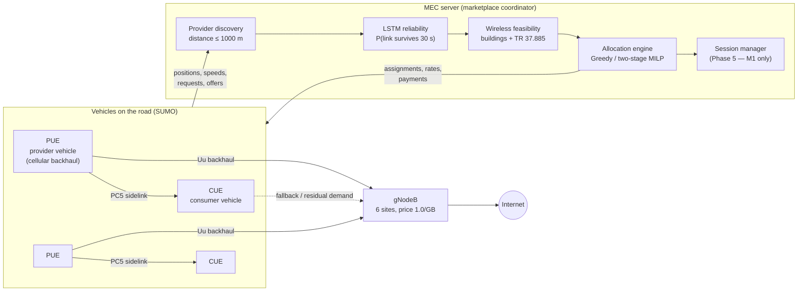
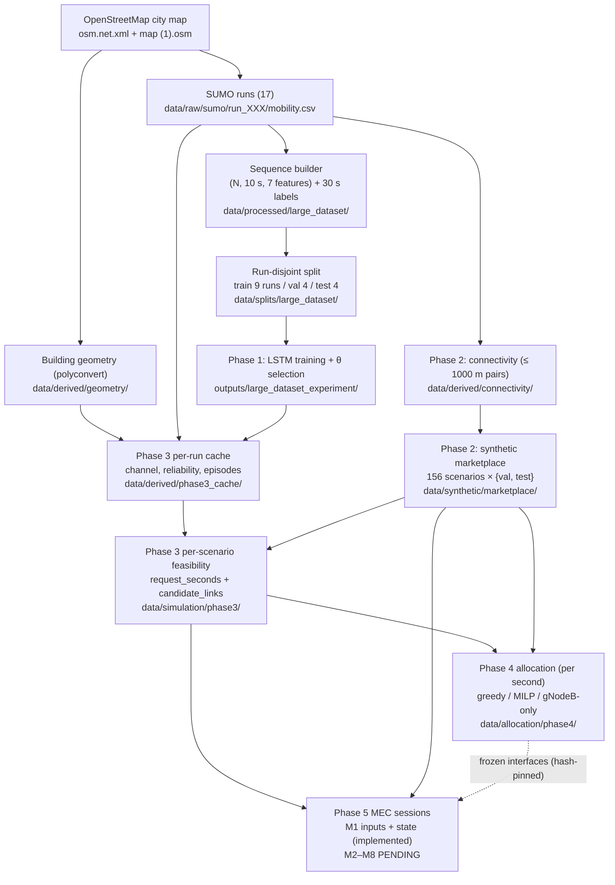
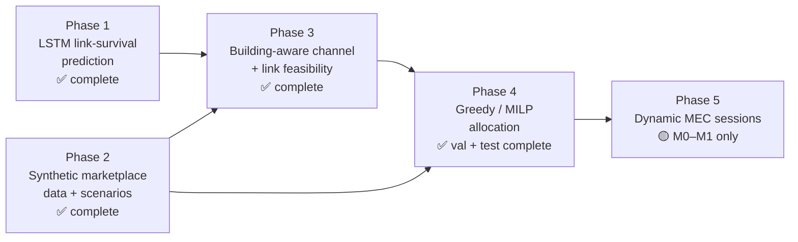
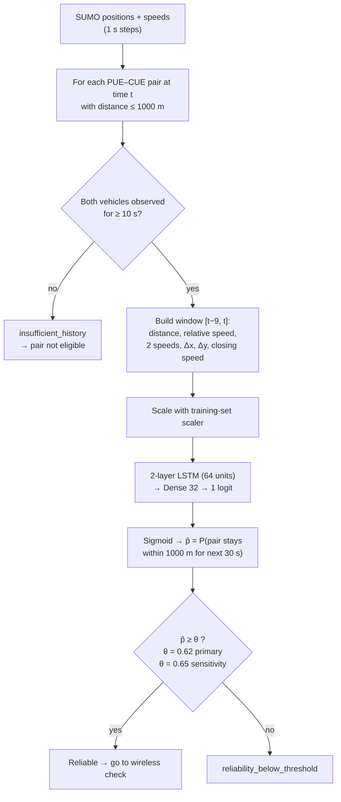
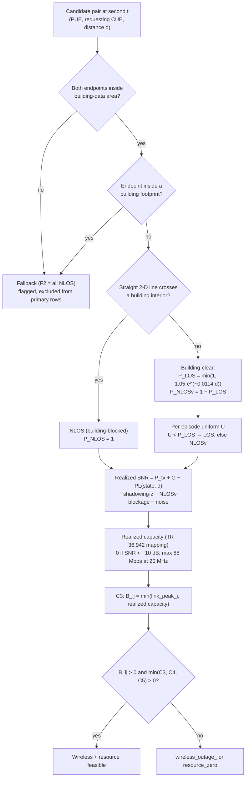
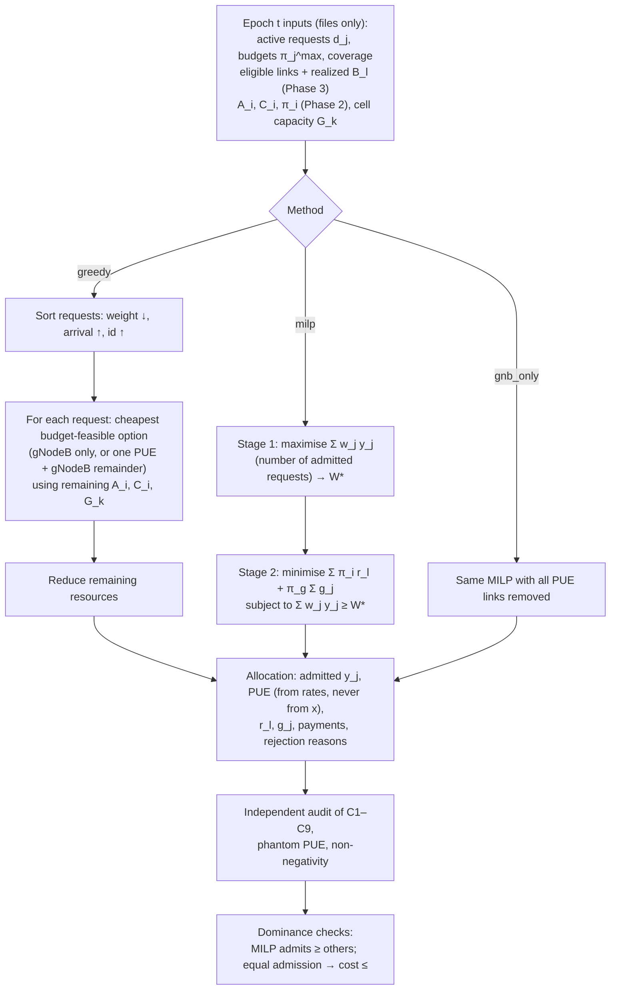
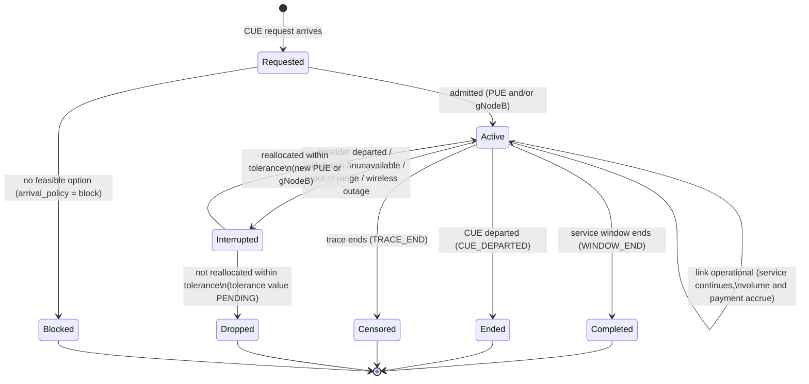

# Project Architecture — MEC-Assisted Internet Sharing Marketplace

> Companion documents: [COMPLETE_PROJECT_DOCUMENTATION.md](COMPLETE_PROJECT_DOCUMENTATION.md) (full technical
> reference), [PROFESSOR_PROJECT_GUIDE.md](PROFESSOR_PROJECT_GUIDE.md) (readable overview),
> [PROJECT_VIVA_QUESTIONS.md](PROJECT_VIVA_QUESTIONS.md) (questions and answers).
>
> Everything here was checked against the repository on 2026-11-25. Where a component is planned but not
> implemented, it is marked **PENDING**.

---

## 1. Entities and their roles

| Entity | What it is in this project | Where it lives in the repository |
|---|---|---|
| **PUE** (Provider UE) | A vehicle that has its own cellular Internet connection (the *backhaul*) and offers part of it to nearby vehicles for a posted price per GB. Modelled as an NR sidelink **U2N relay UE**. | Mobility: SUMO traces (`data/raw/sumo/<run>/mobility.csv`). Resources and price: Phase 2 `pue_resources.csv.gz`. |
| **CUE** (Consumer UE) | A vehicle that needs Internet service. It sends a request with a data rate, duration and the maximum price it accepts. Modelled as a **U2N remote UE**. | Phase 2 `cue_requests.csv.gz`. |
| **gNodeB** | A cellular base station. It serves any demand the PUEs cannot or should not serve, at a fixed price of 1.0 price unit/GB. Six fixed sites. | `infrastructure.add.xml` (6 `gNodeB` POIs), Phase 2 `gnodeb_resources.csv.gz`, `src/network/coverage.py`. |
| **MEC server** | The marketplace coordinator at the network edge. It sees vehicle positions, the LSTM's predictions and the radio estimates, and decides who serves whom. | Phases 3–4 implement its *decision logic* as offline code. Phase 5 (`src/mec/`) adds session management — **only milestone M1 is implemented**. A `MEC-1` POI exists in `infrastructure.add.xml`, but its location is not used in any calculation. |
| **SUMO** | The open-source traffic simulator that produces realistic vehicle movement on an OpenStreetMap city map. | `scripts/generate_sumo_runs.py`, `data/raw/sumo/` (17 runs). |
| **LSTM reliability predictor** | A neural network that reads the last 10 s of a PUE–CUE pair's movement and outputs the probability that the pair stays within 1000 m for the next 30 s. | `src/models/lstm.py`, `src/models/predictor.py`, `src/reliability/`, checkpoint in `outputs/large_dataset_experiment/checkpoints/`. |
| **Wireless channel model** | Decides whether the PUE–CUE radio link actually works and how many Mbps it carries. Uses building outlines (LOS/NLOS) and 3GPP TR 37.885 equations. | `src/network/` (`buildings.py`, `channel_state.py`, `tr37885.py`), `src/simulation/`. |
| **Marketplace allocation engine** | Every second, decides which requests to admit, which PUE (at most one) serves each request, at what rate, and how much the gNodeB serves. Greedy heuristic and an exact two-stage MILP. | `src/marketplace/`, `scripts/run_phase4_allocation.py`. |

---

## 2. Overall system architecture

**How to read it.** Vehicles report positions and offers/requests to the MEC server. The MEC server filters
possible provider–consumer pairs in three separate stages (distance, LSTM reliability, radio feasibility),
then allocates. A served consumer receives data from one PUE over the sidelink, from the gNodeB, or from
both (one PUE plus a gNodeB top-up).

---

## 3. End-to-end data flow (files actually produced)

**Important separation rule.** Each phase consumes only the *files* written by earlier phases. Phase 4
(`src/marketplace/`) imports no LSTM, radio or simulation code, and Phase 5 (`src/mec/`) may import only the
frozen Phase 4 interfaces plus a few utilities. Tests check both rules (`tests/test_marketplace.py`,
`tests/test_mec_state.py`).

---

## 4. Phase-wise pipeline

| Phase | Input | Output | Status (repository evidence) |
|---|---|---|---|
| 1 | SUMO traces | Trained LSTM, θ = 0.62 (primary), θ = 0.65 (sensitivity) | Complete. Checkpoint protected by SHA-256. |
| 2 | SUMO traces + assumed parameters | 156 scenarios per split (val, test) | Complete. 6,216 checks per split passed. Reproducible byte-for-byte. |
| 3 | SUMO, buildings, LSTM, Phase 2 | Per-second candidate links with stage flags | Complete for val and test. |
| 4 | Phase 2 + Phase 3 files | Per-second allocations, metrics, comparisons | Complete for val (frozen 2026-11-25 01:10) and test (written 01:51). |
| 5 | Phase 2 + 3 files, frozen Phase 4 | Sessions, reallocation, continuity metrics | **M0/M1 implemented (config, input adapter, state manager; 35 tests). M2–M8 not implemented.** |

---

## 5. LSTM prediction workflow

---

## 6. Wireless channel evaluation (Phase 3, scenario G)

Scenarios **F1** (same OSM road → LOS/NLOSv, otherwise NLOS), **F2** (everything NLOS, conservative) and
**F3** (everything building-clear, optimistic) replace the geometry test with simpler rules for sensitivity
analysis.

---

## 7. Greedy / MILP allocation workflow (Phase 4, one epoch = one second)

---

## 8. MEC dynamic session lifecycle (Phase 5 — design intent)

> **Status.** Only the *observation layer* (M1) is implemented: `StateManager` can classify, for any second,
> whether a provider is present, departed, withdrawn, temporarily unavailable or out of range, and whether
> a link is *operational* or *policy-eligible*. The session state machine below (admission, interruption,
> reallocation, accounting) is the **planned** M2–M5 behaviour and is **not implemented**. Its detailed design
> document ("Design Revision 2") is referenced in code but is not stored in the repository.

What the implemented M1 code already distinguishes (from `src/mec/state.py`):

| Provider condition at second t | Meaning | Rule |
|---|---|---|
| `PUE_NOT_YET_PRESENT` | Vehicle has not entered the simulation | t < first second in trace |
| `PUE_DEPARTED` | Vehicle left the road network | t > its last second (only possible if that second is before trace end) |
| `PUE_WITHDRAWN` | Provider permanently stopped selling | Phase 2 withdrawal time ≤ t |
| `PUE_UNAVAILABLE` | Temporarily off (on/off availability) or not registered | Phase 2 status |
| `PUE_OUT_OF_RANGE` | Present and available but > 1000 m from the CUE | no Phase 3 candidate row |
| `LINK_OBSERVED` | A candidate link exists; carries *operational* and *policy-eligible* flags | Phase 3 row |

| Request end cause | Rule |
|---|---|
| `WINDOW_END` | Nominal end (start + duration − 1) reached while the CUE is still present |
| `CUE_DEPARTED` | CUE left before the nominal end, and before the trace ended |
| `TRACE_END` | CUE still present when the SUMO run ended — **censored**, not counted as a departure |

---

## 9. Code packages and dependency rules

| Package | Responsibility |
|---|---|
| `src/mobility` | Load SUMO traces; vehicle roles and lifetimes |
| `src/features` | Kinematic features, LSTM labels, sequence windows, scaler |
| `src/models`, `src/training` | LSTM network, predictor wrapper, training loop, checkpoints |
| `src/reliability` | `ReliabilityModel` interface, LSTM adapter, kinematic baseline, `ThresholdPolicy`, online feature builder |
| `src/network` | Link-model interface, TR 37.885 NR sidelink model, buildings, LOS/NLOS classifiers, gNodeB coverage |
| `src/datagen` | Phase 2 synthetic PUE/CUE/gNodeB generation, connectivity, validation |
| `src/simulation` | Phase 3 channel/reliability caches, feasibility stages, validation |
| `src/marketplace` | Phase 4 problem builder, pricing, admission, greedy, MILP, audit, evaluation |
| `src/mec` | Phase 5: `Phase5Config`, `Phase5ScenarioInputs`, `StateManager` (M1 only) |
| `src/common`, `src/utils` | Units (1 GB = 8000 Mb), strict config loader, seeding, SHA-256 integrity |

Rules enforced by tests: no import cycles; `network` does not import `models`/`reliability`/`datagen`;
`marketplace` imports no reliability/radio code; `mec` imports only frozen Phase 4 interfaces, `common`,
`mobility.trace` and `utils`.
